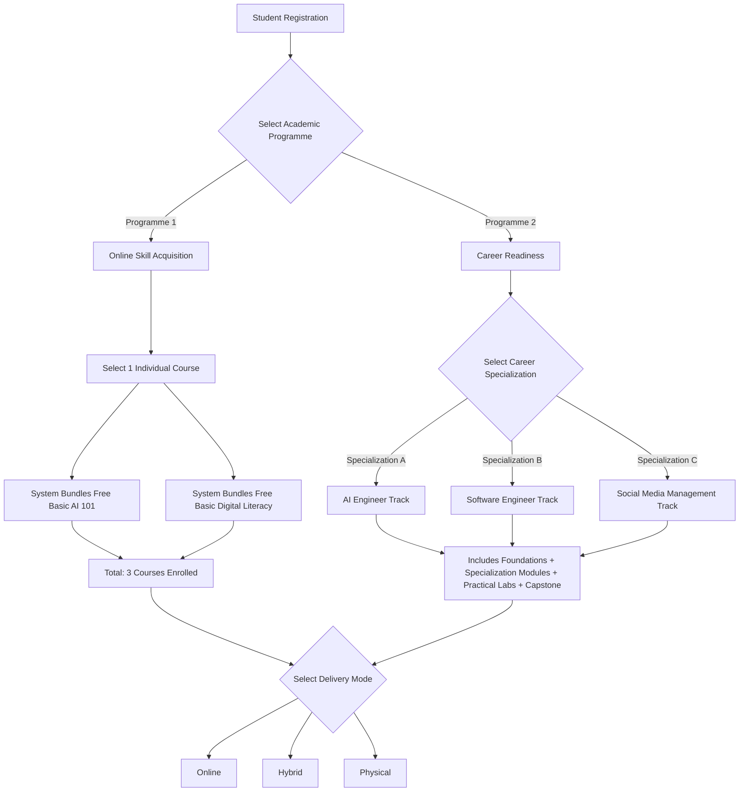
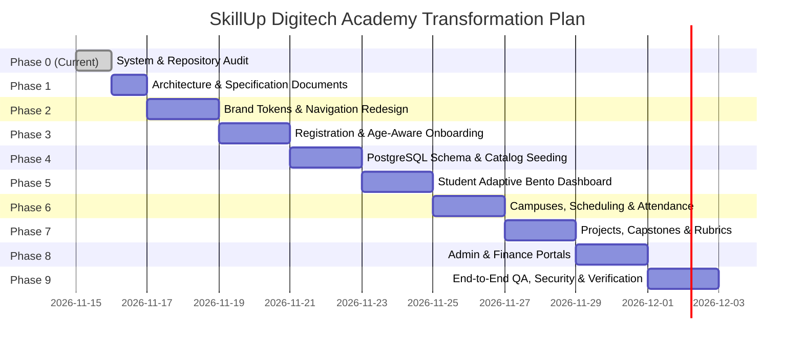

# SKILLUP DIGITECH ACADEMY — REBRAND V2 IMPLEMENTATION AUDIT (SYNCHRONIZED V2.1)

> **Document Version:** 2.1.0 (Synchronized with Browser & Full UI/UX Audit Suite — 2026-11-17)  
> **Status:** Backend Academic Infrastructure Completed (39 PostgreSQL tables, 10 seeded master courses, 5 cohorts, Enugu Campus & Labs, Hardened Cookie Auth) — **UI/UX Rebrand V2 Audit Complete & Awaiting Implementation Approval**  
> **Target Platform:** SkillUp Digitech Academy (`skillup-digitech.com.ng`)  
> **Execution Environment:** Next.js 16.1.6 App Router, React 19.2, TypeScript 5, PostgreSQL (Neon), Brevo Transactional Email, npm  
> **Authoritative Rebrand V2 UI/UX Audit Suite (`docs/audits/`):**
> - [Browser & Visual Experience Audit](docs/audits/SKILLUP_REBRAND_V2_BROWSER_AUDIT.md)
> - [Master UI/UX & Product Audit](docs/audits/SKILLUP_REBRAND_V2_MASTER_AUDIT.md)
> - [User Journeys & Screen Specifications](docs/audits/SKILLUP_REBRAND_V2_USER_JOURNEYS.md)
> - [Component Audit & Shared Design System](docs/audits/SKILLUP_REBRAND_V2_COMPONENT_AUDIT.md)
> - [Phased Implementation Roadmap](docs/audits/SKILLUP_REBRAND_V2_IMPLEMENTATION_ROADMAP.md)
> - [Complete Page & Route Inventory](docs/audits/SKILLUP_REBRAND_V2_PAGE_INVENTORY.md)

> **Note on Synchronization (2026-11-17):** Sections 1–11 below preserve the original Phase 0 baseline snapshot taken before PostgreSQL academic catalog seeding and scheduling were built. For the **current live state** (including browser-verified UX defects, live 39-table PostgreSQL counts, 66-component classification, 68-route inventory, and the updated 8-phase Rebrand V2 UI/UX roadmap), treat the 6 synchronized documents in `docs/audits/` as the active source of truth.  

---

## 1. Executive Summary & Audit Purpose

This audit represents the complete **Phase 0 baseline investigation** of the existing LMS repository, establishing the exact technical, architectural, operational, and visual state before any code is modified.

### Core Objectives of the Transformation
The goal is to transition the platform into **SkillUp Digitech Academy**, an institution delivering technology education through two distinct academic programmes:
1. **Online Skill Acquisition:** Individual specialized technology courses with guaranteed complimentary bundling of **Basic AI 101** and **Basic Digital Literacy**.
2. **Career Readiness:** Comprehensive career tracks (**AI Engineer**, **Software Engineer**, **Social Media Management**) bundling specialized modules, foundation courses, practical projects, and capstone evaluations.

Both programmes are delivered through three configurable delivery modes:
- **Physical:** In-person training at campus centres with verified classroom/computer capacity and attendance tracking.
- **Hybrid:** Synchronous in-person lab sessions combined with live virtual classes and asynchronous online coursework.
- **Online:** Pure remote learning with live interactive sessions and digital lab environments.

### Non-Negotiable Operational Constraints Observed
- **Framework & Runtime:** Next.js App Router (Turbopack, Next 16.1.6), React 19, TypeScript.
- **Package Manager:** Strict adherence to **`npm`** (never `pnpm`).
- **Database Engine:** Neon PostgreSQL via Drizzle ORM (`DATABASE_BACKEND=postgres`). The legacy MongoDB database is completely disconnected and preserved untouched.
- **Transactional Email Provider:** **Brevo (`@getbrevo/brevo`) is the sole email engine**. No other email service or fallback is permitted.
- **Data Integrity:** Strict prohibition on synthetic/fake student records, fake instructors, fake payments, or fake certificates.
- **Phase 0 Boundary:** Strict read-only audit. No production code or database migrations are applied until this audit is formally approved.

---

## 2. Complete Repository Architecture & Route Map

A full structural inspection of the `app/` hierarchy reveals the following route topology and functional distribution:

```
app/
├── (auth)/
│   ├── forgot-password/page.tsx          # Password recovery initiation
│   ├── login/page.tsx                    # Multi-role authentication (student, instructor, admin, finance)
│   ├── register/page.tsx                 # Public registration hub
│   ├── register-instructor/page.tsx      # Instructor application & credentials intake
│   ├── register-online/page.tsx          # Online training registration route
│   ├── register-onsite/                  # Legacy onsite training registration
│   │   ├── page.tsx
│   │   └── success/page.tsx
│   ├── reset-password/page.tsx           # Password token reset form
│   └── verify-otp/page.tsx               # 6-digit email OTP verification screen
├── (public)/
│   ├── layout.tsx                        # Public layout wrapping PublicHeader and PublicFooter
│   ├── page.tsx                          # Public Academy Landing Page (Hero, Value Prop, Courses)
│   ├── about/page.tsx                    # Academy mission, vision, leadership
│   ├── contact/page.tsx                  # Contact form & campus coordinates
│   ├── courses/                          # Public course discovery catalog
│   │   ├── page.tsx
│   │   └── [slug]/page.tsx               # Course syllabus, instructor info, enrollment trigger
│   ├── faq/page.tsx                      # Frequently asked questions
│   ├── privacy/page.tsx                  # Student privacy policy & safeguarding terms
│   ├── refund/page.tsx                   # Fee refund policy & installment terms
│   ├── terms/page.tsx                    # Academic terms of service
│   └── campaign/promptcare-academy/      # [LEGACY] Healthcare campaign page to be decommissioned
├── dashboard/                            # Student Learning Console
│   ├── layout.tsx                        # Student sidebar, header, milestone listener
│   ├── page.tsx                          # Primary student dashboard / overview
│   ├── courses/                          # Student enrolled courses catalog
│   │   ├── page.tsx
│   │   └── [courseId]/
│   │       ├── page.tsx                  # Course overview & syllabus progress
│   │       └── learn/page.tsx            # Active lesson player, notes, quiz trigger
│   ├── onsite-training/                  # [LEGACY] Healthcare onsite training tab (to be refactored)
│   │   ├── page.tsx
│   │   └── success/page.tsx
│   ├── payments/                         # Student payment history & installment invoices
│   │   ├── page.tsx
│   │   └── [paymentId]/page.tsx          # Individual payment receipt & breakdown
│   ├── certificates/page.tsx             # Earned credentials & verification badges
│   └── profile/                          # Student identity & settings
│       ├── page.tsx
│       └── setup/page.tsx                # Post-registration onboarding wizard
├── instructor/                           # Instructor Academic Console
│   ├── layout.tsx                        # Instructor console layout & permissions boundary
│   ├── page.tsx                          # Instructor overview & class stats
│   ├── analytics/page.tsx                # Class engagement & student performance metrics
│   ├── courses/                          # Assigned & authored curriculum
│   │   ├── page.tsx
│   │   ├── new/page.tsx                  # Course creation wizard
│   │   └── [courseId]/
│   │       ├── page.tsx
│   │       ├── content/page.tsx          # Module, lesson, quiz builder
│   │       └── edit/page.tsx             # Course metadata editor
│   ├── evaluations/page.tsx              # Student project & assignment grading queue
│   ├── settings/page.tsx                 # Instructor availability & notification settings
│   └── upload/page.tsx                   # Course resource & asset staging
├── admin/                                # Administrative Governance Portal
│   ├── layout.tsx                        # Administrative sidebar & RBAC guard
│   ├── page.tsx                          # Executive KPI dashboard
│   ├── analytics/page.tsx                # Institutional metrics (enrollments, revenue, completion)
│   ├── categories/page.tsx               # Technology subject taxonomy manager
│   ├── courses/                          # Master curriculum oversight
│   │   ├── page.tsx
│   │   └── [courseId]/...
│   ├── onsite-training/page.tsx          # [LEGACY] Physical training admin (to be refactored to Campuses/Cohorts)
│   ├── payments/                         # Financial ledger, offline verifications, refund handling
│   │   ├── page.tsx
│   │   ├── verify/page.tsx
│   │   └── [paymentId]/page.tsx
│   ├── settings/page.tsx                 # System configuration & feature flags
│   ├── students/page.tsx                 # Student registry & enrollment manager
│   └── users/page.tsx                    # User access control & role assignment
├── finance/                              # Dedicated Finance Portal
│   ├── layout.tsx
│   ├── page.tsx
│   ├── reports/page.tsx                  # Revenue, installment arrears, Paystack settlement
│   └── transactions/                     # Audited payment records
│       ├── page.tsx
│       └── [paymentId]/page.tsx
├── checkout/                             # Transaction checkout flow
│   ├── page.tsx
│   ├── failed/page.tsx
│   └── success/page.tsx
├── cart/page.tsx                         # Course cart / selection checkout
├── welcome/                              # Post-OTP Onboarding Redirects
│   ├── student/page.tsx                  # Student journey router
│   └── instructor/page.tsx               # Instructor profile activation
└── api/                                  # API Route Handlers
    ├── auth/                             # Login, register, logout, OTP, password recovery
    ├── courses/                          # Public catalog, module content, lesson progress
    ├── enrollments/                      # Student course access, completion tracking
    ├── payments/                         # Paystack init, verify, webhooks, reconciliation
    ├── onboarding/                       # Onboarding state persistence & draft caching
    ├── profile/                          # User profile mutation
    ├── cron/                             # Background Brevo notification recovery worker
    └── instructor/                       # Grading submissions, rubric evaluations
```

---

## 3. Authentication, Authorization & RBAC Analysis

### Existing Role Hierarchy
Defined in `lib/authorization.ts` and `lib/types.ts`:
- **`student`**: Granted `student:read`, `student:update`, `certificate:create`.
- **`instructor`**: Granted `course:create`, `course:update`, `course:publish`, `instructor:read`, `instructor:update`, `student:read`.
- **`admin`**: Full administrative permissions across courses, students, instructors, payments, and system settings.
- **`finance`**: Restricted financial auditing (`payment:read`, `payment:verify`, `admin:read`).

### Token & Session Lifecycle
- **JWT Encoding:** Handled via `lib/jwt.ts` and `lib/session-token.ts` with HMAC-SHA256 signing using `JWT_SECRET`.
- **Edge Middleware Compatibility:** Refactored during Phase 0 to ensure zero Node.js native runtime leaks (`@getbrevo/brevo` is fully excluded from middleware execution via isolated `session-token.ts`).
- **Cookie Security:** Cookies (`auth_token`) use `HttpOnly`, `SameSite=Lax`, and `Secure` (in production).
- **Password Protection:** Encrypted with `bcryptjs` (salt rounds: 10).

### Key Architectural Findings & Deficiencies
1. **Lack of Age-Aware Role Differentiation:** The current RBAC model treats all students identically. It lacks attributes or sub-roles distinguishing **Secondary School Students (<18)** from **Adult Learners**.
2. **Missing Safeguarding Gates:** Minors require explicit parental/guardian consent verification (`guardianConsentStatus: 'pending' | 'verified' | 'rejected'`) before open communications with instructors can be activated.
3. **Instructor-Student Direct Communication Guardrails:** Unmoderated 1-to-1 messaging between instructors and minor students is currently unprotected. A structured query/moderated ticketing system must be enforced for secondary school students.

---

## 4. PostgreSQL Database Schema & Migration Audit

### Architecture & ORM Setup
The database layer is managed with **Drizzle ORM** connecting to a hosted Neon PostgreSQL cluster via `@neon/config` and standard `pg` Pool (`DATABASE_BACKEND=postgres`). Schema definitions reside in `db/schema/core.ts` and `db/schema/academic.ts`.

### Existing Schema Inventory
The existing PostgreSQL schema contains 26 primary tables:

| Schema File | Table Name | Purpose & Existing Schema Status |
| :--- | :--- | :--- |
| `core.ts` | `users` | Primary identity table (`id`, `email`, `password`, `role`, `status`, `emailVerified`, `studentProfile`, `instructorProfile`, `onboardingState`, `studentMilestones`). |
| `core.ts` | `pendingRegistrations` | Temporary staging for unverified registrations pending OTP verification. |
| `core.ts` | `categories` | Technology course subject taxonomies. |
| `core.ts` | `courses` | Master curriculum catalog (`id`, `title`, `slug`, `price`, `level`, `published`, `instructorId`). |
| `core.ts` | `courseModules` | Course syllabus sections. |
| `core.ts` | `lessons` | Granular learning units with text/video/resource payload. |
| `core.ts` | `enrollments` | Student course association (`status`, `progress`, `completedAt`). |
| `core.ts` | `payments` | Financial transactions (`amount`, `currency`, `provider`, `reference`, `status`, `paymentType`). |
| `core.ts` | `paymentEvents` | Audit log for webhooks and state transitions. |
| `core.ts` | `certificates` | Issued credentials with unique verification hash. |
| `core.ts` | `quizzes` | Multiple-choice knowledge assessments. |
| `core.ts` | `quizQuestions` | Individual questions with options and answer keys. |
| `core.ts` | `assignments` | Practical homework tasks. |
| `core.ts` | `learningNotes` | Student per-lesson personal notebooks. |
| `core.ts` | `adminLogs` | Administrative audit trail. |
| `core.ts` | `onboardingEvents` | Telemetry for registration drop-off tracking. |
| `core.ts` | `migrationAudit` | Historical database migration tracking. |
| `core.ts` | `tableRelationships` | Relational integrity metadata. |
| `core.ts` | `appSettings` | Key-value application configuration store. |
| `core.ts` | `notificationDispatches`| Brevo email outbox with lease lock, idempotency key, and retry schedule. |
| `academic.ts` | `quizAttempts` | Student assessment scores and answers. |
| `academic.ts` | `assignmentSubmissions`| Student homework files and repository links. |
| `academic.ts` | `rubrics` | Criteria-based grading scales. |
| `academic.ts` | `grades` | Formal academic evaluation records. |
| `academic.ts` | `gradeHistory` | Audited grade revisions. |
| `academic.ts` | `projects` | Milestone and capstone project definitions. |
| `academic.ts` | `projectSubmissions` | Student portfolio code and project links. |

### Live Database Data Audit
Executed via non-destructive audit script on the active Neon PostgreSQL database:
- **`users` Count:** 5 authentic records
  - 1 System Administrator: `spacecontactme0@gmail.com`
  - 2 Staging Instructors: `Dr. Staging Instructor` (assigned to test curriculum)
  - 2 Verified Students: `schmidtcarmenr@gmail.com`, `cordellanathan8@gmail.com`
- **`courses` Count:** 0 records (Awaiting technology catalog seeding).
- **`enrollments` Count:** 0 records.
- **`payments` Count:** 0 records.
- **`categories` Count:** 2 technology categories provisioned.

### Crucial Architectural Deficiencies in Current Database
1. **Conflation of Delivery Mode with Programme Type:** The existing schema lacks first-class concepts for **Delivery Modes** (`physical | hybrid | online`). The legacy code treated "onsite" as a payment type or ad-hoc marketing flag rather than an academic operational modality.
2. **Absence of Physical Infrastructure Entities:** There are no tables for **`campuses`** (locations, venues), **`classrooms`** (computer lab capacity, physical seat limits), **`cohorts`** (intake dates, delivery mode binding, max capacity), **`classSessions`** (scheduled calendar blocks), and **`sessionAttendance`** (physical check-ins).
3. **Absence of Secondary School Safeguarding Fields:** `users` lacks structured fields for `schoolName`, `gradeLevel`, `guardianName`, `guardianEmail`, `guardianPhone`, `guardianConsentStatus`, and `dateOfBirth`.
4. **Missing Automatic Programme Bundling Associations:** `courses` does not currently model relationship links for bundled prerequisite/foundation courses (**Basic AI 101** and **Basic Digital Literacy**).

---

## 5. Course, Program, Enrollment & Payment Workflows

### Master Technology Catalog (The 10 Approved Courses)
The academy must support 10 authentic master courses across the two academic programmes:
1. **Basic Digital Literacy** *(Foundation Course — Complimentary for Skill Acquisition & Bundled for Career Readiness)*
2. **Basic AI 101** *(Foundation Course — Complimentary for Skill Acquisition & Bundled for Career Readiness)*
3. **AI Engineering** *(Career Readiness Track Course)*
4. **AI Automation** *(Specialist Course)*
5. **Frontend Development** *(Career Readiness Track Course)*
6. **Backend Development** *(Career Readiness Track Course)*
7. **Digital Marketing** *(Specialist Course)*
8. **Graphic Design** *(Specialist Course)*
9. **Video Editing** *(Specialist Course)*
10. **Social Media Management** *(Career Readiness Track Course)*

### Academic Programme Structure & Business Logic


### Payment & Paystack Integration
- **Gateway:** Paystack (`lib/paystack.ts`) handles NGN, USD, and GBP transactions.
- **Installment Plans:** The current code in `lib/onsite-checkout.ts` supports partial payments (minimum initial deposit of 50%, remaining balance tracked in `payments.metadata`). This must be formalized across all programmes and delivery modes with automated balance due alerts.
- **Webhook Idempotency:** Implemented via `app/api/payments/webhook/route.ts` with SHA-512 signature validation and event logging in `paymentEvents`.

---

## 6. Brevo Email Integration & Template Audit

### Architecture & Service Reliability
- **Client Implementation:** Located in `lib/email/client.ts`, strictly utilizing the official `@getbrevo/brevo` SDK.
- **Server Isolation:** `assertServerOnly()` guarantees zero exposure to client-side code.
- **Idempotent Queue Worker:** Managed via `lib/email/idempotency.ts` and `notificationDispatches` table. Uses 5-minute lease locks and exponential backoff retry schedules to prevent duplicate sends.

### Existing Template Inventory (`lib/email/templates/`)
- `base.ts`: Standardized HTML layout with brand header and footer.
- `verification.ts`: Email OTP verification with security expiration.
- `welcome.ts`: Initial account welcome.
- `enrollment-confirmation.ts`: Course enrollment confirmation.
- `payment-confirmation.ts`: Payment receipt with transaction breakdown.
- `payment-alert.ts`: Administrative payment notification.
- `password-reset.ts`: Secure password reset link.
- `curriculum-review.ts`: Course approval notifications for instructors.

### Missing Email Workflows Requiring Implementation
1. **Parent/Guardian Consent Request:** Dispatched when a secondary school student registers, containing a secure verification token for parental approval.
2. **Guardian Consent Verified Notice:** Dispatched to both student and parent once consent is confirmed.
3. **Classroom Schedule & Campus Allocation:** Dispatched to physical and hybrid students confirming venue, room number, computer station, and timetable.
4. **Attendance Warning Notice:** Automated alert when a physical/hybrid learner misses mandatory sessions.
5. **Assignment & Project Feedback Alert:** Notification when an instructor grades an assignment or capstone milestone.
6. **Certificate Verification & Share Link:** Graduation email providing PDF download and public verification credentials.

---

## 7. Reusable UI Component Inventory & Design System Audit

### Brand Identity & Design Tokens (Rebrand V2)
The application currently uses scattered Tailwind color classes. It must be consolidated into design tokens honoring the approved Rebrand V2 palette:

| Token Name | Hex Code | Purpose & Contrast Rule |
| :--- | :--- | :--- |
| **Russian Violet** | `#231651` | Primary brand background & deep text. High contrast with White and Mint. |
| **Deep Night Plum** | `#150C33` | Dark mode surface & deep container background. |
| **Electric Violet** | `#613399` | Interactive accents, hover states, badges, and progress indicators. |
| **Mint Green** | `#D6FFF6` | High-visibility action accents, primary CTAs, completion badges. |
| **Emerald Text** | `#0A5C4A` | Text placed on top of Mint Green backgrounds to satisfy WCAG AA (4.5:1). |
| **Soft Ice Lavender**| `#E8E3F5` | Subtle borders, light card backgrounds, secondary pill tags. |
| **White** | `#FFFFFF` | Clean background cards and primary light text. |
| **Light Canvas** | `#F8FAFB` | Main application body background for daytime readability. |

### UI Component Inventory
Located across `components/ui/`, `components/skillup/`, and `components/academic/`:
- **Shadcn UI Primitives:** `button`, `card`, `dialog`, `dropdown-menu`, `input`, `label`, `progress`, `select`, `sheet`, `tabs`, `textarea`, `toast`, `badge`.
- **Academic Components:** `AssignmentSubmissionPanel.tsx`, `CapstoneProjectPanel.tsx`, `QuizRunner.tsx`, `TechnicalContentRenderer.tsx`.
- **Layout & Navigation:** `public-header.tsx`, `public-footer.tsx`, `dashboard-nav.tsx`, `dashboard-header.tsx`.

### Navigation Architecture Audit
- **Current Public Header:** Features traditional horizontal desktop links (`Courses`, `About`, `Contact`, `Campaign`, `Sign In`, `Register`).
- **Required Rebrand V2 Navigation:** A streamlined **2-item minimalist header**:
  1. **Home** (Logo/Brand Link).
  2. **Get Started** (Interactive Trigger).
- **Required "Get Started" Push Drawer:** Must open a responsive side drawer that **shifts/pushes the main page content** (rather than obscuring it as a dark modal overlay) and presents dual pathways:
  - *Get Started as a Student* (Direct entry into age-aware onboarding).
  - *Get Started as an Instructor* (Instructor application).

---

## 8. Legacy Healthcare & PromptCare Audit

A thorough search across the repository identified residue from the previous healthcare LMS ("PromptCare" / "Caregiver" training) that must be cleanly refactored:

| File Path | Line(s) | Legacy Reference / Content | Proposed Refactoring |
| :--- | :--- | :--- | :--- |
| `lib/onsite-training-shared.ts` | 40, 57 | "Become a World-Class Certified Caregiver in 21 Days", scrubs, CPR, patient care | Replace with SkillUp Technology Campus Training (AI, Software Engineering, Digital Media). |
| `lib/student-registration.ts` | 4, 18 | Caregiver training defaults & static Enugu/Abuja health campuses | Update to dynamic SkillUp campus venues and technology cohorts. |
| `app/dashboard/onsite-training/page.tsx` | 158, 317 | "Certified Caregiver" badges and hospital clinical placement text | Refactor to "Physical & Hybrid Learning Schedule" showing lab stations and timetables. |
| `app/(public)/campaign/promptcare-academy/*` | Whole dir | Entire directory is dedicated to the legacy healthcare campaign | Decommission route; redirect to `/courses` or technology career tracks. |
| `lib/campaign-shared.ts` | 49, 84 | Caregiver campaign defaults and discount configurations | Replace with Technology Career Launchpad campaign. |
| `lib/brand-config.ts` | 13 | Fallback brand descriptions | Ensure complete technology academy wording ("Practical Technology Skills & Engineering Academy"). |

---

## 9. Gap Analysis Against the 20 Acceptance Criteria

Each of the 20 mandatory acceptance criteria has been evaluated against the existing codebase:

| # | Acceptance Criterion | Current Status | Current State & Technical Remedy Required |
| :-: | :--- | :---: | :--- |
| **AC1** | Secondary school student registration with safeguarded onboarding | **Not Met** | Registration form is monolithic. Requires minor flow with guardian consent intake and safeguarding fields in PostgreSQL. |
| **AC2** | Adult learner registration process | **Partially Met** | Basic registration exists (`app/(auth)/register`), but lacks programme/delivery mode selection and streamlined UX. |
| **AC3** | Selection of Online Skill Acquisition vs Career Readiness | **Not Met** | Courses are listed flatly. No programme selector exists in the registration flow or database associations. |
| **AC4** | Selection of course or career specialization | **Partially Met** | Course listing exists, but 3 career specializations (AI Engineer, Software Engineer, Social Media Management) are not bundled. |
| **AC5** | Delivery mode selection (Physical, Hybrid, Online) | **Partially Met** | Legacy "onsite" exists as a separate checkout form. Needs unification into first-class delivery mode selector. |
| **AC6** | Prevention of unavailable modes & full cohorts | **Not Met** | No cohort capacity validation exists. Enrolments currently occur without checking classroom/seat constraints. |
| **AC7** | Physical & hybrid campus schedule view | **Not Met** | Student dashboard has a static caregiver onsite tab. Must be replaced with real-time class schedule, room, and timetable view. |
| **AC8** | Online & hybrid learning activities access | **Met** | Course learning player (`app/dashboard/courses/[courseId]/learn`) is operational with video, modules, and notes. |
| **AC9** | Automatic enrollment in free foundation courses | **Not Met** | No auto-enrollment hook exists to bundle free Basic AI 101 and Basic Digital Literacy upon paid specialist course enrollment. |
| **AC10**| Lesson progress continuation and tracking | **Met** | Lesson completion tracking exists in `enrollments.progress` and `app/api/enrollments/[id]/progress`. |
| **AC11**| Instructor class management and assessment | **Partially Met**| Instructor evaluation page exists (`app/instructor/evaluations`), but lacks cohort filtering and attendance management. |
| **AC12**| Student practical project submissions & feedback | **Met** | `projects`, `projectSubmissions`, and `rubrics` tables exist in `academic.ts`; UI panels exist in `components/academic/`. |
| **AC13**| Capstone project completion requirements | **Partially Met**| Capstone UI exists, but academic rules preventing graduation without passing capstones need enforcement. |
| **AC14**| Authorized graduation & certificate approval | **Partially Met**| Admin can view certificates, but automated academic graduation approval workflow needs completion. |
| **AC15**| Certificate download & public verification | **Met** | Public certificate verification endpoint and hash verification exist in `certificates` table. |
| **AC16**| Admin management of programmes, cohorts, schedules | **Partially Met**| Admin can manage courses and users, but lacks dedicated Campus, Classroom, Cohort, and Schedule managers. |
| **AC17**| Secure payment verification & installment handling | **Met** | Paystack integration, webhook verification, and installment metadata tracking are fully functional. |
| **AC18**| Exclusive transactional email using Brevo | **Met** | Brevo SDK configured with server isolation and idempotent queue worker. Zero Resend references. |
| **AC19**| Rebrand V2 visual interface & design tokens | **Partially Met**| Palette defined in documentation; public header, get started push drawer, and dashboard bento grid need visual implementation. |
| **AC20**| Preservation of existing working LMS functionality | **Met** | Authentication, database persistence, Paystack payments, and quiz engines are intact and verified. |

---

## 10. Risk Analysis, Safeguards & Change Control Strategy

### Technical & Architectural Risks
1. **Middleware Compilation Hazards:** Next.js Edge Middleware cannot load Node-specific native modules (such as Brevo or crypto libraries).
   - *Safeguard:* Maintain clean separation. Only lightweight JWT verification (`lib/session-token.ts`) is imported into `proxy.ts`.
2. **Database Migration Disruption:** Applying destructive schema alterations to Neon PostgreSQL could risk existing user accounts or system logs.
   - *Safeguard:* Use additive, non-destructive migrations (`drizzle-kit generate` with explicit review). Never drop legacy tables or alter column types abruptly.
3. **Double-Booking & Cohort Overcapacity:** Race conditions during simultaneous registrations could oversubscribe physical computer labs.
   - *Safeguard:* Implement PostgreSQL transaction isolation with `SELECT ... FOR UPDATE` when locking cohort seat inventory during checkout initialization.
4. **Child Safeguarding Vulnerabilities:** Minors (<18) accessing unmoderated public forums or receiving unmonitored private direct messages.
   - *Safeguard:* Automated guardian consent verification before account activation; unmoderated direct messaging disabled for minor accounts.

---

## 11. Proposed Phased Implementation Roadmap

Following Phase 0 approval, the implementation will execute strictly according to the documented phase gates:



### Detailed Breakdown of Upcoming Phases:

- **Phase 1 — Academic & Product Architecture (Specifications)**
  - Deliverables:
    - `SKILLUP_ACADEMY_PRODUCT_ARCHITECTURE.md`
    - `SKILLUP_ACADEMY_DATABASE_DESIGN.md`
    - `SKILLUP_ACADEMY_REGISTRATION_AND_ONBOARDING.md`
    - `SKILLUP_ACADEMY_SCHEDULING_SPECIFICATION.md`

- **Phase 2 — Brand Foundation & Public Navigation**
  - Implement Tailwind design tokens for Russian Violet, Mint Green, Deep Night Plum, Electric Violet, Soft Ice Lavender.
  - Implement the minimalist 2-item header (`Home` + `Get Started`).
  - Implement the responsive content-shift push drawer (content pushes to the left when drawer opens).
  - Modernize public homepage with programme discovery and interactive course cards.

- **Phase 3 — Registration & Age-Aware Onboarding**
  - Implement progressive selection: Learner Category (Secondary School vs Adult) -> Academic Programme (Skill Acquisition vs Career Readiness) -> Course/Track -> Delivery Mode (Physical, Hybrid, Online) -> Campus/Cohort -> Payment Option.
  - Implement single-box OTP input.
  - Implement Guardian Safeguarding consent email dispatch.

- **Phase 4 — Academic Database & Curriculum Seeding**
  - Generate Drizzle migration for `campuses`, `classrooms`, `cohorts`, `classSessions`, `sessionAttendance`, and guardian consent columns.
  - Seed the 10 approved technology master courses and define the automated foundation bundling triggers.

- **Phase 5 — Learner Dashboard & Learning Interface**
  - Implement adaptive Bento-grid dashboard tailored to delivery mode (Physical timetable vs Online lab).
  - Enhance lesson player with interactive 3D and Framer Motion micro-interactions.
  - Add "Write to Instructor" support ticket modal.

- **Phase 6 — Scheduling, Attendance & Instructor Workflows**
  - Implement campus capacity validation and schedule conflict prevention.
  - Provide instructors with cohort rosters and QR/one-click attendance marking.

- **Phase 7 — Projects, Capstones & Certification**
  - Complete capstone submission, rubric grading, and graduation evaluation workflows.
  - Provide branded verifiable PDF certificates with QR code verification.

- **Phase 8 — Administration & Operations**
  - Add administrative tools for Campus/Classroom management, Cohort creation, and Guardian consent auditing.

- **Phase 9 — End-to-End Testing, Security & Verification**
  - Comprehensive automated test suite execution (`npm run test:security`, `npm run test:academic`, `npm run test:payments`, `npm run test:email`).
  - Deliverables:
    - `SKILLUP_ACADEMY_TEST_REPORT.md`
    - `SKILLUP_ACADEMY_IMPLEMENTATION_LOG.md`

---

## 12. Sign-Off & Approval Request (Synchronized 2026-11-17)

The Phase Zero live browser audit, full repository UI/UX audit, competitive research, component classification, user journey redesign, page inventory, and 8-phase Rebrand V2 UI/UX implementation roadmap are complete in `docs/audits/`.

**Next Action:** Awaiting stakeholder review and approval of the `docs/audits/SKILLUP_REBRAND_V2_*.md` audit suite before initiating **Phase 1 — Brand & Design Foundation**. No UI redesign code has been implemented during this audit.
