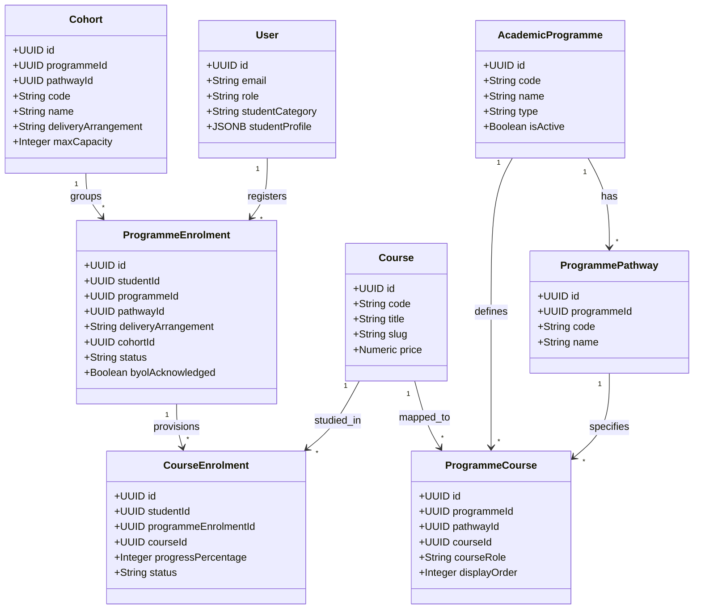
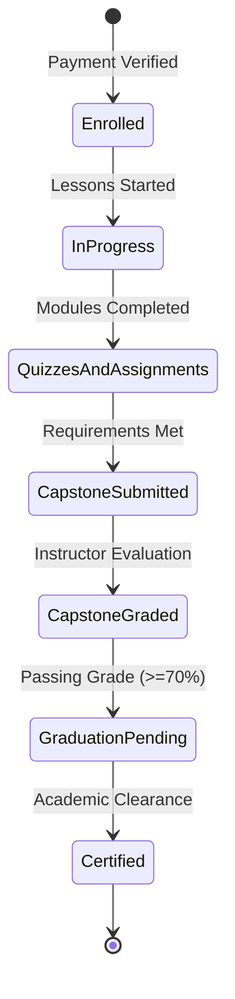

# SKILLUP DIGITECH ACADEMY — ACADEMIC DOMAIN MODEL SPECIFICATION

> **Document ID:** SDA-ADM-003  
> **Version:** 1.0.0  
> **Status:** Proposed — For Architecture Review & Management Approval  
> **Date:** 15 November 2026  
> **Platform:** SkillUp Digitech Academy (`skillup-digitech.com.ng`)  

---

## 1. Domain Model Overview & Key Principles

The core requirement of SkillUp Digitech Academy is the clean architectural separation of five distinct concepts:
1. **User Identity:** A persistent student or staff account (`users`).
2. **Academic Programme:** An institutional curriculum container (`academic_programmes`).
3. **Career Pathway:** A specialized career track within a programme (`programme_pathways`).
4. **Master Course:** An atomic, reusable subject curriculum (`courses`).
5. **Delivery Arrangement:** An operational modality (`online` or `hybrid`).

---

## 2. Entity Definitions & Specifications

### 2.1 Academic Programmes (`academic_programmes`)
Defines the top-level academic product offering.

- `id` (UUID, PK)
- `code` (VARCHAR(50), Unique, e.g., `CAREER_READINESS`, `SKILL_ACQUISITION`)
- `name` (VARCHAR(255), e.g., "Career Readiness Programme", "Skill Acquisition Programme")
- `type` (VARCHAR(50), `career_readiness` | `skill_acquisition`)
- `description` (TEXT)
- `allowedDeliveryModes` (JSONB, e.g., `["online", "hybrid"]` for Career Readiness, `["online"]` for Skill Acquisition)
- `isActive` (BOOLEAN, default `true`)
- `createdAt` / `updatedAt` (TIMESTAMPTZ)

### 2.2 Programme Pathways (`programme_pathways`)
Specializations available within a programme (primarily for Career Readiness).

- `id` (UUID, PK)
- `programmeId` (UUID, FK -> `academic_programmes.id`)
- `code` (VARCHAR(50), Unique, e.g., `AI_ENGINEER`, `SOFTWARE_ENGINEER`, `SOCIAL_MEDIA_MANAGEMENT`)
- `name` (VARCHAR(255), e.g., "AI Engineer", "Software Engineer", "Social Media Management")
- `description` (TEXT)
- `targetOutcomes` (JSONB, array of strings)
- `isActive` (BOOLEAN, default `true`)
- `createdAt` / `updatedAt` (TIMESTAMPTZ)

### 2.3 Master Courses (`courses` — Reusing & Extending Existing Table)
The atomic unit of curriculum containing modules, lessons, videos, and quizzes.

- `id` (UUID, PK)
- `code` (VARCHAR(50), e.g., `BDL-101`, `AI-101`, `AIE-201`, `FED-201`)
- `title` (VARCHAR(255))
- `slug` (VARCHAR(255), Unique)
- `description` (TEXT)
- `price` (NUMERIC(12,2))
- `level` (VARCHAR(50), `beginner` | `intermediate` | `advanced`)
- `instructorId` (UUID, FK -> `users.id`)
- `isFoundationCourse` (BOOLEAN, default `false` — used for *Basic Digital Literacy* & *Basic AI 101*)
- `published` (BOOLEAN, default `true`)

### 2.4 Programme Courses Mapping (`programme_courses`)
Resolves the many-to-many relationship between programmes/pathways and master courses. This allows a master course (e.g., *Basic Digital Literacy*) to be reused across Career Readiness and Skill Acquisition without duplicating course rows.

- `id` (UUID, PK)
- `programmeId` (UUID, FK -> `academic_programmes.id`)
- `pathwayId` (UUID, Nullable, FK -> `programme_pathways.id`)
- `courseId` (UUID, FK -> `courses.id`)
- `courseRole` (VARCHAR(50), `core` | `foundation` | `supporting` | `elective`)
- `displayOrder` (INTEGER, default 1)
- `isMandatoryForGraduation` (BOOLEAN, default `true`)
- `createdAt` (TIMESTAMPTZ)

### 2.5 Programme Enrolments (`programme_enrolments`)
The central contract between a student and an academic programme for a specific intake.

- `id` (UUID, PK)
- `studentId` (UUID, FK -> `users.id`)
- `programmeId` (UUID, FK -> `academic_programmes.id`)
- `pathwayId` (UUID, Nullable, FK -> `programme_pathways.id`)
- `deliveryArrangement` (VARCHAR(50), `online` | `hybrid`)
- `cohortId` (UUID, Nullable, FK -> `cohorts.id`)
- `status` (VARCHAR(50), `pending_payment` | `active` | `completed` | `suspended` | `withdrawn`)
- `enrolledAt` (TIMESTAMPTZ)
- `completedAt` (TIMESTAMPTZ, Nullable)
- `byolAcknowledged` (BOOLEAN, default `false`)
- `byolAcknowledgedAt` (TIMESTAMPTZ, Nullable)
- `metadata` (JSONB, agreed package snapshot, terms version)
- `createdAt` / `updatedAt` (TIMESTAMPTZ)

### 2.6 Course Enrolments (`course_enrolments` / `enrollments`)
Tracks granular learning progress across individual courses bundled under a programme.

- `id` (UUID, PK)
- `studentId` (UUID, FK -> `users.id`)
- `programmeEnrolmentId` (UUID, FK -> `programme_enrolments.id`)
- `courseId` (UUID, FK -> `courses.id`)
- `status` (VARCHAR(50), `active` | `completed` | `dropped`)
- `progress` (INTEGER, default 0, 0–100%)
- `currentLessonId` (UUID, Nullable, FK -> `lessons.id`)
- `completedAt` (TIMESTAMPTZ, Nullable)
- `createdAt` / `updatedAt` (TIMESTAMPTZ)

---

## 3. Bundling Business Logic

### 3.1 Skill Acquisition Auto-Bundling Engine
When a student enrolls and pays for any individual specialist course under the Skill Acquisition programme:
1. System creates one `programme_enrolments` record with `programmeType = 'skill_acquisition'` and `deliveryArrangement = 'online'`.
2. System provisions the primary selected `course_enrolments` row (e.g., *Graphic Design*).
3. System automatically identifies the two approved foundation courses:
   - *Basic Digital Literacy* (`BDL-101`)
   - *Basic AI 101* (`AI-101`)
4. System provisions two additional `course_enrolments` rows linked to the same `programmeEnrolmentId`, setting `isComplimentary = true` and fee = 0.
5. All three courses immediately appear in the student's dashboard.

### 3.2 Career Readiness Track Bundling
When a student enrolls in a Career Readiness track (e.g., *AI Engineer*):
1. System queries `programme_courses` for all courses mapped to `pathway = AI_ENGINEER`.
2. Automatically provisions course enrolments for:
   - *Basic Digital Literacy* (Foundation)
   - *Basic AI 101* (Foundation)
   - *AI Engineering* (Core Curriculum)
   - *AI Automation* (Supporting/Core)
3. Connects the student to the active capstone project requirement (`projects` table).

---

## 4. Academic Progression, Evaluation & Certification

### Graduation Rules
A student achieves certificate eligibility when all of the following conditions are met:
1. **Module Completion:** 100% of required lessons in core courses completed.
2. **Assignment & Quiz Pass Rate:** Weighted average grade on quizzes and practical assignments $\ge 60\%$.
3. **Attendance Threshold:** For hybrid enrolments, minimum $75\%$ verified attendance across scheduled physical and live virtual classes.
4. **Capstone Evaluation:** Formal passing evaluation ($\ge 70\%$) on the final capstone project from an authorized instructor.
5. **Academic Integrity:** Zero unaddressed plagiarism or misconduct flags.
