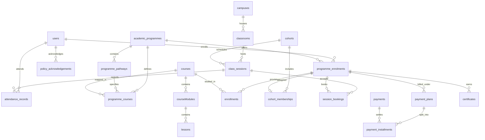

# SKILLUP DIGITECH ACADEMY — DATABASE SCHEMA & MIGRATION DESIGN

> **Document ID:** SDA-DBS-004  
> **Version:** 1.0.0  
> **Status:** Proposed — For Architecture Review & Management Approval  
> **Date:** 15 November 2026  
> **Platform:** SkillUp Digitech Academy (`skillup-digitech.com.ng`)  
> **Engine:** Neon PostgreSQL, Drizzle ORM (`DATABASE_BACKEND=postgres`)  

---

## 1. Existing-to-Target Schema Analysis

The current database consists of 26 operational PostgreSQL tables across `db/schema/core.ts` and `db/schema/academic.ts`. All existing tables, constraints, and rows (including the 5 active user accounts) will be preserved with **100% data integrity**.

### Table Mapping Matrix

| Existing Table | Role in New Architecture | Action Required |
| :--- | :--- | :--- |
| `users` | Core user identity & authentication | **Preserve & Extend** with minor safeguarding columns (`studentCategory`, `dateOfBirth`, `schoolName`). |
| `pendingRegistrations` | Registration draft & OTP verification | **Preserve & Extend** with draft state, selected programme/delivery mode, and BYOL acknowledgement flag. |
| `categories` | Technology subject taxonomy | **Preserve**. |
| `courses` | Master course curriculum catalog | **Preserve & Extend** with `code`, `isFoundationCourse` flag. |
| `courseModules` | Course sections | **Preserve as-is**. |
| `lessons` | Atomic video & text lessons | **Preserve as-is**. |
| `enrollments` | Course-level student progress | **Preserve & Connect** via foreign key to `programme_enrolments`. |
| `payments` | Paystack transaction records | **Preserve & Connect** to specific `programme_enrolments`. |
| `paymentEvents` | Webhook audit log | **Preserve as-is**. |
| `certificates` | Verification credentials | **Preserve & Extend** with `programmeEnrolmentId` reference. |
| `quizzes`, `quizQuestions`| Knowledge tests | **Preserve as-is**. |
| `assignments` | Practical homework | **Preserve as-is**. |
| `learningNotes` | Student notebooks | **Preserve as-is**. |
| `adminLogs` | Administrative audit trail | **Preserve as-is**. |
| `notificationDispatches`| Brevo email outbox | **Preserve as-is** (idempotent queue). |
| `quizAttempts` | Student assessment scores | **Preserve as-is**. |
| `assignmentSubmissions`| Student homework files | **Preserve as-is**. |
| `rubrics`, `grades` | Academic grading system | **Preserve as-is**. |
| `projects`, `projectSubmissions`| Milestone & Capstone projects | **Preserve as-is**. |

---

## 2. Target Relational Architecture Diagram



---

## 3. Exact Proposed Schema Additions (Drizzle ORM)

All proposed additions will reside in a new schema definition file: `db/schema/academy-v2.ts` (re-exported via `db/schema/index.ts`).

### 3.1 Academic Programmes & Pathways
```typescript
export const academicProgrammes = pgTable("academic_programmes", {
  id: uuid("id").primaryKey().defaultRandom(),
  code: varchar("code", { length: 50 }).notNull().unique(), // 'CAREER_READINESS', 'SKILL_ACQUISITION'
  name: varchar("name", { length: 255 }).notNull(),
  type: varchar("type", { length: 50 }).notNull(), // 'career_readiness', 'skill_acquisition'
  description: text("description"),
  allowedDeliveryModes: jsonb("allowed_delivery_modes").notNull().default(["online"]),
  isActive: boolean("is_active").notNull().default(true),
  createdAt: timestamp("created_at", { withTimezone: true }).notNull().defaultNow(),
  updatedAt: timestamp("updated_at", { withTimezone: true }).notNull().defaultNow(),
})

export const programmePathways = pgTable("programme_pathways", {
  id: uuid("id").primaryKey().defaultRandom(),
  programmeId: uuid("programme_id").notNull().references(() => academicProgrammes.id),
  code: varchar("code", { length: 50 }).notNull().unique(), // 'AI_ENGINEER', 'SOFTWARE_ENGINEER', 'SOCIAL_MEDIA_MANAGEMENT'
  name: varchar("name", { length: 255 }).notNull(),
  description: text("description"),
  isActive: boolean("is_active").notNull().default(true),
  createdAt: timestamp("created_at", { withTimezone: true }).notNull().defaultNow(),
  updatedAt: timestamp("updated_at", { withTimezone: true }).notNull().defaultNow(),
})

export const programmeCourses = pgTable("programme_courses", {
  id: uuid("id").primaryKey().defaultRandom(),
  programmeId: uuid("programme_id").notNull().references(() => academicProgrammes.id),
  pathwayId: uuid("pathway_id").references(() => programmePathways.id),
  courseId: text("course_id").notNull().references(() => courses.id), // matches existing courses.id type
  courseRole: varchar("course_role", { length: 50 }).notNull().default("core"), // 'foundation', 'core', 'supporting', 'elective'
  displayOrder: integer("display_order").notNull().default(1),
  isMandatory: boolean("is_mandatory").notNull().default(true),
  createdAt: timestamp("created_at", { withTimezone: true }).notNull().defaultNow(),
}, (t) => ({
  uniqProgCourse: uniqueIndex("uniq_programme_course").on(t.programmeId, t.pathwayId, t.courseId),
}))
```

### 3.2 Programme Enrolments
```typescript
export const programmeEnrolments = pgTable("programme_enrolments", {
  id: uuid("id").primaryKey().defaultRandom(),
  studentId: text("student_id").notNull().references(() => users.id),
  programmeId: uuid("programme_id").notNull().references(() => academicProgrammes.id),
  pathwayId: uuid("pathway_id").references(() => programmePathways.id),
  deliveryArrangement: varchar("delivery_arrangement", { length: 50 }).notNull(), // 'online', 'hybrid'
  cohortId: uuid("cohort_id").references(() => cohorts.id),
  status: varchar("status", { length: 50 }).notNull().default("pending_payment"), // 'pending_payment', 'active', 'completed', 'suspended', 'withdrawn'
  byolAcknowledged: boolean("byol_acknowledged").notNull().default(false),
  byolAcknowledgedAt: timestamp("byol_acknowledged_at", { withTimezone: true }),
  metadata: jsonb("metadata").default({}),
  enrolledAt: timestamp("enrolled_at", { withTimezone: true }),
  completedAt: timestamp("completed_at", { withTimezone: true }),
  createdAt: timestamp("created_at", { withTimezone: true }).notNull().defaultNow(),
  updatedAt: timestamp("updated_at", { withTimezone: true }).notNull().defaultNow(),
}, (t) => ({
  studentProgIdx: index("idx_prog_enrol_student").on(t.studentId, t.status),
}))
```

### 3.3 Physical Campus, Classrooms & Cohorts
```typescript
export const campuses = pgTable("campuses", {
  id: uuid("id").primaryKey().defaultRandom(),
  name: varchar("name", { length: 255 }).notNull(), // e.g. "Enugu Main Learning Centre"
  slug: varchar("slug", { length: 100 }).notNull().unique(),
  address: text("address").notNull(),
  city: varchar("city", { length: 100 }).notNull(),
  state: varchar("state", { length: 100 }).notNull(),
  contactPhone: varchar("contact_phone", { length: 50 }),
  contactEmail: varchar("contact_email", { length: 100 }),
  facilities: jsonb("facilities").default(["electricity_backup", "student_wifi", "air_conditioning"]),
  isActive: boolean("is_active").notNull().default(true),
  createdAt: timestamp("created_at", { withTimezone: true }).notNull().defaultNow(),
  updatedAt: timestamp("updated_at", { withTimezone: true }).notNull().defaultNow(),
})

export const classrooms = pgTable("classrooms", {
  id: uuid("id").primaryKey().defaultRandom(),
  campusId: uuid("campus_id").notNull().references(() => campuses.id),
  name: varchar("name", { length: 100 }).notNull(), // e.g. "Lab 1 - Turing Room"
  roomNumber: varchar("room_number", { length: 50 }),
  safeCapacity: integer("safe_capacity").notNull().default(30), // Max physical seating capacity
  powerOutletsCount: integer("power_outlets_count").notNull().default(30),
  isActive: boolean("is_active").notNull().default(true),
  createdAt: timestamp("created_at", { withTimezone: true }).notNull().defaultNow(),
})

export const cohorts = pgTable("cohorts", {
  id: uuid("id").primaryKey().defaultRandom(),
  programmeId: uuid("programme_id").notNull().references(() => academicProgrammes.id),
  pathwayId: uuid("pathway_id").references(() => programmePathways.id),
  code: varchar("code", { length: 50 }).notNull().unique(), // e.g. 'SE-2026-Q1-HYB'
  name: varchar("name", { length: 255 }).notNull(),
  deliveryArrangement: varchar("delivery_arrangement", { length: 50 }).notNull(), // 'online', 'hybrid'
  campusId: uuid("campus_id").references(() => campuses.id),
  defaultClassroomId: uuid("default_classroom_id").references(() => classrooms.id),
  maxCapacity: integer("max_capacity").notNull().default(30),
  startDate: date("start_date").notNull(),
  endDate: date("end_date").notNull(),
  status: varchar("status", { length: 50 }).notNull().default("enrolling"), // 'upcoming', 'enrolling', 'active', 'completed', 'archived'
  fixedTimetableSummary: text("fixed_timetable_summary"), // e.g. "Wed 17:00-19:00 Virtual, Sat 10:00-14:00 Physical"
  createdAt: timestamp("created_at", { withTimezone: true }).notNull().defaultNow(),
  updatedAt: timestamp("updated_at", { withTimezone: true }).notNull().defaultNow(),
})

export const cohortMemberships = pgTable("cohort_memberships", {
  id: uuid("id").primaryKey().defaultRandom(),
  cohortId: uuid("cohort_id").notNull().references(() => cohorts.id),
  programmeEnrolmentId: uuid("programme_enrolment_id").notNull().references(() => programmeEnrolments.id),
  studentId: text("student_id").notNull().references(() => users.id),
  status: varchar("status", { length: 50 }).notNull().default("active"),
  joinedAt: timestamp("joined_at", { withTimezone: true }).notNull().defaultNow(),
}, (t) => ({
  uniqMember: uniqueIndex("uniq_cohort_student").on(t.cohortId, t.studentId),
}))
```

### 3.4 Scheduling, Bookings & Attendance
```typescript
export const classSessions = pgTable("class_sessions", {
  id: uuid("id").primaryKey().defaultRandom(),
  cohortId: uuid("cohort_id").notNull().references(() => cohorts.id),
  courseId: text("course_id").references(() => courses.id),
  title: varchar("title", { length: 255 }).notNull(),
  description: text("description"),
  activityType: varchar("activity_type", { length: 50 }).notNull(), // 'live_virtual', 'physical_class', 'physical_practical', 'virtual_workshop'
  deliveryChannel: varchar("delivery_channel", { length: 50 }).notNull(), // 'online', 'physical', 'simultaneous_hybrid'
  campusId: uuid("campus_id").references(() => campuses.id),
  classroomId: uuid("classroom_id").references(() => classrooms.id),
  instructorId: text("instructor_id").references(() => users.id),
  sessionDate: date("session_date").notNull(),
  startTime: time("start_time").notNull(),
  endTime: time("end_time").notNull(),
  meetingUrl: text("meeting_url"),
  maxCapacity: integer("max_capacity").notNull(),
  bookedSeatsCount: integer("booked_seats_count").notNull().default(0),
  status: varchar("status", { length: 50 }).notNull().default("scheduled"), // 'scheduled', 'in_progress', 'completed', 'cancelled', 'rescheduled'
  changeReason: text("change_reason"),
  createdAt: timestamp("created_at", { withTimezone: true }).notNull().defaultNow(),
  updatedAt: timestamp("updated_at", { withTimezone: true }).notNull().defaultNow(),
})

export const sessionBookings = pgTable("session_bookings", {
  id: uuid("id").primaryKey().defaultRandom(),
  sessionId: uuid("session_id").notNull().references(() => classSessions.id),
  programmeEnrolmentId: uuid("programme_enrolment_id").notNull().references(() => programmeEnrolments.id),
  studentId: text("student_id").notNull().references(() => users.id),
  status: varchar("status", { length: 50 }).notNull().default("confirmed"), // 'confirmed', 'cancelled', 'waitlisted'
  bookedAt: timestamp("booked_at", { withTimezone: true }).notNull().defaultNow(),
}, (t) => ({
  uniqBooking: uniqueIndex("uniq_session_student_booking").on(t.sessionId, t.studentId),
}))

export const attendanceRecords = pgTable("attendance_records", {
  id: uuid("id").primaryKey().defaultRandom(),
  sessionId: uuid("session_id").notNull().references(() => classSessions.id),
  studentId: text("student_id").notNull().references(() => users.id),
  programmeEnrolmentId: uuid("programme_enrolment_id").notNull().references(() => programmeEnrolments.id),
  attendanceStatus: varchar("attendance_status", { length: 50 }).notNull(), // 'present', 'absent', 'excused', 'late'
  attendanceChannel: varchar("attendance_channel", { length: 50 }).notNull(), // 'physical', 'virtual'
  verifiedBy: text("verified_by").references(() => users.id), // Instructor or staff ID
  verifiedAt: timestamp("verified_at", { withTimezone: true }).notNull().defaultNow(),
  notes: text("notes"),
}, (t) => ({
  uniqAttendance: uniqueIndex("uniq_session_student_attendance").on(t.sessionId, t.studentId),
}))
```

### 3.5 Policy & BYOL Acknowledgements
```typescript
export const policyAcknowledgements = pgTable("policy_acknowledgements", {
  id: uuid("id").primaryKey().defaultRandom(),
  userId: text("user_id").notNull().references(() => users.id),
  programmeEnrolmentId: uuid("programme_enrolment_id").references(() => programmeEnrolments.id),
  policyType: varchar("policy_type", { length: 50 }).notNull(), // 'byol_policy', 'guardian_consent', 'code_of_conduct'
  policyVersion: varchar("policy_version", { length: 20 }).notNull().default("v1.0"),
  ipAddress: varchar("ip_address", { length: 50 }),
  userAgent: text("user_agent"),
  acknowledgedAt: timestamp("acknowledged_at", { withTimezone: true }).notNull().defaultNow(),
  metadata: jsonb("metadata").default({}),
})
```

---

## 4. Transactional Integrity & Concurrency Safeguards

### Concurrent Physical Seat Booking (AC11, AC12)
To prevent race conditions and overbooking when multiple students attempt to register for the final seat in a cohort or physical workshop:
```sql
-- Executed inside an atomic transaction:
BEGIN;
SELECT id, safe_capacity, booked_seats_count 
FROM class_sessions 
WHERE id = $sessionId 
FOR UPDATE;

-- Application checks if booked_seats_count < safe_capacity:
-- If valid:
INSERT INTO session_bookings (session_id, student_id, programme_enrolment_id, status)
VALUES ($sessionId, $studentId, $enrolmentId, 'confirmed');

UPDATE class_sessions 
SET booked_seats_count = booked_seats_count + 1 
WHERE id = $sessionId;

COMMIT;
```

---

## 5. Non-Destructive Additive Migration Plan

1. **Step 1 — Create New Academy Tables:** Run migration script executing the new table creations (`academic_programmes`, `campuses`, `cohorts`, etc.). Zero existing tables are dropped or modified.
2. **Step 2 — Add Non-Breaking Columns to Existing Tables:**
   - Add `programme_enrolment_id` (nullable FK) to `enrollments`, `payments`, `certificates`.
   - Add `is_foundation_course` (boolean default false) to `courses`.
   - Add `student_category` (varchar default 'adult') to `users`.
3. **Step 3 — Seed Master Academy Programmes & Pathways:** Insert core records for Career Readiness and Skill Acquisition with pathways.
4. **Step 4 — Seed 10 Authentic Master Courses:** Seed technology courses with idempotent conflict handling (`ON CONFLICT (slug) DO UPDATE`).
5. **Step 5 — Verification:** Execute `tests/database/staging-runtime-verification.test.ts` to confirm 100% relational integrity and zero regressions on existing data.
