# SKILLUP DIGITECH ACADEMY — IMPLEMENTATION ROADMAP & CHANGE-CONTROL PLAN

> **Document ID:** SDA-ROA-009  
> **Version:** 1.0.0  
> **Status:** Proposed — For Architecture Review & Management Approval  
> **Date:** 15 November 2026  
> **Platform:** SkillUp Digitech Academy (`skillup-digitech.com.ng`)  

---

## 1. Phased Implementation Strategy & Approval Gates

To eliminate operational risk, ensure continuous database integrity, and preserve existing working features, the transformation into SkillUp Digitech Academy executes through **eight discrete, gated phases**.

No phase begins until the preceding phase deliverables and tests are verified and approved.

```mermaid
flowchart LR
    P1[Phase 1: Architecture & Specs] -->|Approval Gate| P2[Phase 2: Database & Curriculum]
    P2 -->|Approval Gate| P3[Phase 3: Registration & Onboarding]
    P3 -->|Approval Gate| P4[Phase 4: Learning & Video Experience]
    P4 -->|Approval Gate| P5[Phase 5: Scheduling & Centre Ops]
    P5 -->|Approval Gate| P6[Phase 6: Projects, Capstones & Certs]
    P6 -->|Approval Gate| P7[Phase 7: Finance & Admin Portals]
    P7 -->|Approval Gate| P8[Phase 8: QA & Production Release]
```

---

## 2. Phase-by-Phase Execution Details

### Phase 1 — Architecture, PRD & Specification Finalization (Current Phase)
- **Objective:** Establish the comprehensive architectural blueprint, database design, user journeys, and test plans without altering production code.
- **Deliverables:**
  - `docs/SKILLUP_PRODUCT_REQUIREMENTS.md`
  - `docs/SKILLUP_STUDENT_USER_JOURNEYS.md`
  - `docs/SKILLUP_ACADEMIC_DOMAIN_MODEL.md`
  - `docs/SKILLUP_DATABASE_DESIGN.md`
  - `docs/SKILLUP_SCHEDULING_AND_CENTRE_OPERATIONS.md`
  - `docs/SKILLUP_REGISTRATION_AND_ONBOARDING.md`
  - `docs/SKILLUP_ADMIN_AND_INSTRUCTOR_WORKFLOWS.md`
  - `docs/SKILLUP_ACCEPTANCE_AND_TEST_PLAN.md`
  - `docs/SKILLUP_IMPLEMENTATION_ROADMAP.md`
- **Approval Gate:** Formal review and sign-off by management/lead architect.

---

### Phase 2 — Database Schema Additions & Technology Catalog Seeding
- **Objective:** Provision the new academic database tables in Neon PostgreSQL with zero modification or deletion of existing data.
- **Key Actions:**
  - Add `db/schema/academy-v2.ts` (defining `academicProgrammes`, `programmePathways`, `programmeCourses`, `programmeEnrolments`, `campuses`, `classrooms`, `cohorts`, `cohortMemberships`, `classSessions`, `sessionBookings`, `attendanceRecords`, `policyAcknowledgements`).
  - Add non-breaking nullable references in `db/schema/core.ts` (`programmeEnrolmentId` on `enrollments` and `payments`).
  - Run additive migration via `tsx scripts/migrate-postgres-schema.ts`.
  - Seed the 10 authentic master courses and career pathways idempotently via `scripts/seed-technology-catalog.ts --execute`.
- **Affected Files:**
  - `db/schema/core.ts`, `db/schema/academy-v2.ts`, `db/schema/index.ts`
  - `scripts/seed-technology-catalog.ts`, `scripts/migrate-postgres-schema.ts`
- **Verification:** Run `npm run test:staging-verify` and `npm run test:database`.

---

### Phase 3 — Registration, BYOL Acknowledgement & Onboarding
- **Objective:** Transform the public registration flow to support dual academic programmes, delivery selection, BYOL acknowledgement, minor safeguarding, and single-box OTP.
- **Key Actions:**
  - Update `app/(auth)/register/page.tsx` with guided step navigation.
  - Implement single-box OTP verification component.
  - Integrate minor safeguarding intake (guardian details + email consent token trigger).
  - Implement existing-account detection (prompting login to attach new enrolment).
- **Affected Files:**
  - `app/(auth)/register/page.tsx`, `components/auth/guided-student-registration-form.tsx`
  - `app/api/auth/register/route.tsx`, `app/api/auth/verify-otp/route.ts`
  - `lib/student-registration.ts`, `lib/email/templates/`
- **Verification:** Execute `tests/academic/registration-rules.test.ts` and automated end-to-end registration flow.

---

### Phase 4 — Learning Experience & Unified Student Dashboard
- **Objective:** Build the unified multi-enrolment student dashboard and enhance the course player.
- **Key Actions:**
  - Implement Bento-grid student dashboard (`app/dashboard/page.tsx`) showcasing *My Programmes*.
  - Render isolated progress, schedules, and active learning activities per enrolment.
  - Upgrade course player (`app/dashboard/courses/[courseId]/learn/page.tsx`) with instructor video player, note-taking, and progress tracking.
  - Add "Write to Instructor" support ticket dialog.
- **Affected Files:**
  - `app/dashboard/page.tsx`, `app/dashboard/courses/page.tsx`, `components/skillup/role-dashboard-shell.tsx`
  - `app/dashboard/courses/[courseId]/learn/page.tsx`, `components/learning/TechnicalContentRenderer.tsx`
- **Verification:** Automated component tests and visual Playwright inspection.

---

### Phase 5 — Physical Centre Scheduling & Attendance Workflows
- **Objective:** Operationalize campus classroom management, cohort timetables, capacity validation, and instructor attendance marking.
- **Key Actions:**
  - Implement `/admin/campuses` and `/admin/cohorts` management interfaces.
  - Implement fixed cohort timetable configuration.
  - Implement atomic seat capacity checking (`SELECT ... FOR UPDATE`) in session bookings.
  - Implement instructor attendance console (`/instructor/courses/[courseId]`) with one-click roster check-in.
- **Affected Files:**
  - `app/admin/campuses/`, `app/admin/cohorts/`, `app/instructor/courses/`
  - `app/api/cohorts/`, `app/api/sessions/`, `lib/academic-db.ts`
- **Verification:** Concurrency seat reservation test (`tests/academic/concurrency-booking.test.ts`).

---

### Phase 6 — Practical Projects, Capstone Evaluations & Verified Credentials
- **Objective:** Enable practical homework submissions, rubric-based capstone grading, and cryptographic certificate issuance.
- **Key Actions:**
  - Refactor assignment and capstone submission panel (`components/academic/CapstoneProjectPanel.tsx`).
  - Wire instructor evaluation queue (`/instructor/evaluations`) with standardized rubrics.
  - Implement graduation clearance rule engine: verifies modules (100%), attendance ($\ge 75\%$), and capstone ($\ge 70\%$).
  - Generate verified PDF certificate with QR code linking to `/verify/[code]`.
- **Affected Files:**
  - `components/academic/CapstoneProjectPanel.tsx`, `app/instructor/evaluations/`
  - `app/api/courses/[id]/submissions/`, `app/dashboard/certificates/page.tsx`
- **Verification:** Academic progression tests (`npm run test:academic`).

---

### Phase 7 — Finance Operations & Administration
- **Objective:** Complete installment management, Paystack reconciliation, and executive KPI reporting.
- **Key Actions:**
  - Implement multi-enrolment payment isolation.
  - Build finance installment tracking table (`app/finance/installments`).
  - Add automated Brevo reminder triggers for upcoming and overdue installment deadlines.
- **Affected Files:**
  - `app/finance/`, `app/admin/payments/`, `lib/paystack.ts`, `lib/email/templates/payment-alert.ts`
- **Verification:** Financial test suite (`npm run test:payments`).

---

### Phase 8 — End-to-End QA, Security Regression & Production Readiness
- **Objective:** Full platform verification across all 25 Acceptance Criteria.
- **Key Actions:**
  - Execute full test suite (`npm run test:security`, `npm run test:academic`, `npm run test:payments`, `npm run test:staging-verify`).
  - Execute `npm run build` with Turbopack (confirm zero type errors or lint warnings).
  - Verify zero residual legacy healthcare strings.
  - Finalize `SKILLUP_ACADEMY_TEST_REPORT.md` and `SKILLUP_ACADEMY_IMPLEMENTATION_LOG.md`.
- **Verification:** Zero errors in production build.
