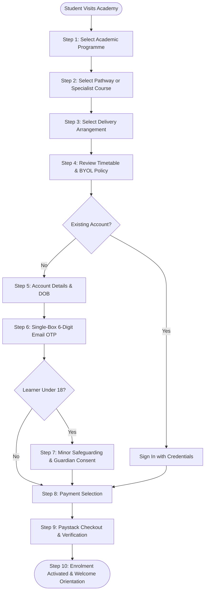

# SKILLUP DIGITECH ACADEMY — REGISTRATION & ONBOARDING SPECIFICATION

> **Document ID:** SDA-REG-006  
> **Version:** 1.0.0  
> **Status:** Proposed — For Architecture Review & Management Approval  
> **Date:** 15 November 2026  
> **Platform:** SkillUp Digitech Academy (`skillup-digitech.com.ng`)  

---

## 1. Unified Registration Experience Overview

The registration system provides a guided, intuitive onboarding journey that clearly communicates the academic programme, delivery arrangement, timetable expectations, and equipment obligations before requesting payment.

---

## 2. Step-by-Step Onboarding Specifications

### Step 1 — Academic Programme Selection
- The student chooses between:
  1. **Career Readiness Programme:** Comprehensive career transformation tracks (AI Engineer, Software Engineer, Social Media Management).
  2. **Skill Acquisition Programme:** Focused individual technology courses (e.g., Graphic Design, Frontend, Backend) with guaranteed complimentary Basic AI 101 and Basic Digital Literacy.

### Step 2 — Pathway or Specialist Course Selection
- If Career Readiness is chosen: presents the 3 career specializations with syllabus breakdown and duration.
- If Skill Acquisition is chosen: displays the technology course catalog with clear pricing and module outlines.

### Step 3 — Delivery Arrangement Selection
- Only available modes configured for the chosen programme/pathway are presented.
- Skill Acquisition presents **Online** as standard, with clear notes on optional weekend physical workshops.
- Career Readiness presents **Online** or **Hybrid**.

### Step 4 — Schedule Review & Mandatory BYOL Acknowledgement
- For Hybrid enrolments:
  - Displays the academy-assigned fixed timetable (e.g., Wednesdays Virtual, Saturdays Physical).
  - Displays the campus location (Enugu Learning Centre).
  - Displays the **Bring Your Own Laptop (BYOL)** policy and academy power/internet guarantee.
  - Requires the student to check the mandatory confirmation box before proceeding.

### Step 5 — Student Account Details & DOB
- Collects: Full Name, Email, Phone Number, Password, and Date of Birth.
- System automatically evaluates student age:
  - Age $\ge 18$: Classified as Adult Learner.
  - Age $13–17$: Classified as Secondary School Student (Minor).

### Step 6 — Streamlined Single-Box OTP Verification
- Avoids fragmented multiple single-character input boxes.
- Implements a single numeric input with auto-formatting, paste support, and clear timer countdown (15 minutes).
- Backed by server-side verification using secure SHA-256 OTP hashing in `pendingRegistrations`.

### Step 7 — Minor Safeguarding & Guardian Consent Intake
- If the student is under 18:
  - Form collects: School Name, Class/Year Level (e.g., SS2), Parent/Guardian Full Name, Guardian Email, and Guardian Emergency Mobile Phone.
  - System automatically queues a Brevo transactional email to the parent with a secure verification token:
    > *"Your child [Student Name] has applied to SkillUp Digitech Academy. Please review the academy safety guidelines and authorize their enrollment."*
  - Account is staged with `guardianConsentStatus: 'pending'` until guardian approval is registered.

### Step 8 — Payment Plan & Checkout
- Offers configured payment terms:
  - **Full Payment:** Single upfront payment with any applicable early-bird incentive.
  - **Installment Plan:** 2 or 3 scheduled installments with transparent due dates.
- Direct integration with Paystack popup modal or redirect checkout.

### Step 9 — Automated Enrolment Activation
- Paystack webhook confirms transaction signature.
- System atomically creates `programme_enrolments` and related `course_enrolments` records.
- Dispatches Brevo welcome orientation email with calendar invite and student portal credentials.

---

## 3. Existing Account Handling (Multi-Enrolment)

If an existing student attempts to register for a new course or programme:
1. When they input their email, the system checks `users` table.
2. If the email exists, the registration banner displays:
   > *"Welcome back! You already have a SkillUp account. Please enter your password to add this programme to your existing dashboard."*
3. Authenticating links the new `programme_enrolments` record to their existing `user.id`.
4. Zero duplicate user rows are created.
5. All previous course progress, certificates, and payment records remain preserved.

---

## 4. Server-Side Draft Persistence & Fault Tolerance

To ensure students never lose form progress due to network glitches or OTP delays:
- All form steps are synchronized asynchronously to `pendingRegistrations.metadata` via `/api/onboarding/state`.
- If the student reloads the page or returns the next day, their draft is restored from their email identifier.
- Drafts automatically expire after 7 days if unverified.
