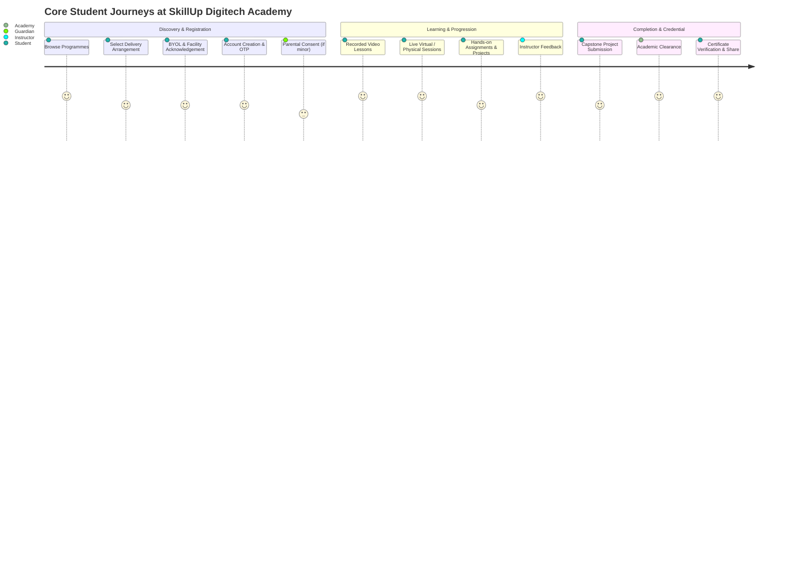

# SKILLUP DIGITECH ACADEMY — STUDENT USER JOURNEYS & INTERACTION SPECIFICATION

> **Document ID:** SDA-UJ-002  
> **Version:** 1.0.0  
> **Status:** Proposed — For Architecture Review & Management Approval  
> **Date:** 15 November 2026  
> **Platform:** SkillUp Digitech Academy (`skillup-digitech.com.ng`)  

---

## 1. Overview of Student Personas & Academic Journeys

The student experience must accommodate both teenagers (aged 13–18, secondary school students) and adult learners (university students, career changers, working professionals). Every interaction emphasizes clarity, transparency regarding equipment and attendance expectations, and seamless access across multiple active enrolments.

---

## 2. Journey A — Online Career Readiness Learner

**Persona:** Amaka, 24, Career Changer enrolling in the **AI Engineer** Career Pathway.

1. **Discovery:**
   - Amaka lands on `https://skillup-digitech.com.ng`.
   - Clicks "Get Started", selecting "Get Started as a Student".
   - Selects **Career Readiness Programme** -> **AI Engineer**.
2. **Delivery Selection:**
   - Chooses **Online** delivery arrangement.
   - The UI presents the online roadmap: 16 weeks, self-paced recorded instructor modules, scheduled weekly live virtual tutorials, remote cloud labs, and a capstone AI deployment project.
3. **Fee & Schedule Transparency:**
   - Reviews transparent pricing (Full Payment vs 2-part Installment).
   - Notes that physical attendance is optional and not compulsory.
4. **Account Creation & Verification:**
   - Enters full name, email, phone number, and password.
   - Enters date of birth (confirms adult status, 18+).
   - Receives 6-digit email OTP via Brevo; enters it into the single-box verification field.
5. **Checkout & Payment:**
   - Selects Paystack checkout (e.g., Initial Installment or Full Payment).
   - Completes secure payment; Paystack webhook notifies the server.
   - Server activates the `programme_enrolments` record with status `active` and delivery `online`.
6. **Orientation & Learning:**
   - Lands on the unified Student Dashboard.
   - Sees **AI Engineer** under *My Programmes*.
   - Automatically receives access to foundational lessons: *Basic Digital Literacy* and *Basic AI 101*.
   - Watches recorded instructor videos, completes coding assignments, and attends Saturday virtual live Q&A via Zoom/Google Meet integration.
7. **Capstone & Graduation:**
   - Submits capstone project (Machine Learning API) to the LMS with GitHub repository and demo link.
   - Instructor reviews project using standardized rubric and assigns grade.
   - System evaluates academic criteria; upon passing, generates verified certificate with cryptographic verification hash.

---

## 3. Journey B — Hybrid Career Readiness Learner

**Persona:** Tunde, 19, Pre-degree student enrolling in **Software Engineer** (Hybrid).

1. **Discovery & Programme Selection:**
   - Navigates through Career Readiness -> **Software Engineer**.
2. **Delivery Arrangement & Fixed Timetable:**
   - Selects **Hybrid** delivery arrangement.
   - The system displays the **Academy-Assigned Fixed Timetable**:
     - *Wednesdays 17:00 – 19:00:* Live Virtual Technical Workshop.
     - *Saturdays 10:00 – 14:00:* Compulsory Physical Lab at SkillUp Centre (Enugu Campus).
     - *Continuous:* Self-paced recorded lessons and coding challenges.
   - Tunde cannot select alternative days; the timetable is fixed for Cohort SE-2026-Q1.
3. **Mandatory BYOL & Facility Acknowledgement:**
   - System displays the Physical Attendance Terms:
     - *"Bring Your Own Laptop (BYOL): You must bring a functional laptop with at least 8GB RAM and Core i5 / equivalent."*
     - *"Academy Guarantee: SkillUp provides dedicated high-speed internet and uninterrupted power (grid + solar/inverter)."*
   - Tunde must check the required checkbox:
     - `[x] I understand I must bring my own laptop. I understand the academy provides electricity and internet.`
4. **Registration, Safeguarding & Checkout:**
   - Submits account details and verifies email OTP.
   - System validates seat availability in Cohort SE-2026-Q1 using transactional row lock.
   - Tunde pays the tuition via Paystack.
5. **Onboarding & Unified Dashboard:**
   - Dashboard Schedule tab combines both virtual and physical activities in one calendar.
   - Saturday physical session displays campus address, classroom number, lab seat number, and BYOL reminder banner.
6. **Physical Attendance & Lab Work:**
   - Tunde arrives at the centre on Saturday with his laptop.
   - Connects to the academy's high-speed student Wi-Fi and power bench.
   - Instructor takes attendance via the instructor portal roster check.
7. **Graduation:**
   - Completes modules, maintains >75% physical attendance, passes Capstone full-stack web application review, and graduates.

---

## 4. Journey C — Skill Acquisition Online Learner

**Persona:** Chidi, 16, Secondary School Student (SS2) learning **Graphic Design**.

1. **Discovery & Course Selection:**
   - Selects **Skill Acquisition Programme** -> **Graphic Design**.
2. **Delivery Model & Complimentary Bundles:**
   - Review indicates delivery is **Online**.
   - Value proposition displays:
     - *Primary Course: Graphic Design (Figma, Photoshop, Brand Identity).*
     - *Complimentary Gift: Basic Digital Literacy (Included Free).*
     - *Complimentary Gift: Basic AI 101 (Included Free).*
3. **Safeguarding & Minor Onboarding Flow:**
   - Chidi enters his date of birth; system detects age is 16 (under 18).
   - Onboarding switches to the **Safeguarded Minor Flow**:
     - Collects student's school name and current grade level (SS2).
     - Collects parent/guardian's full name, email, and mobile phone.
     - Collects parent's emergency contact information.
4. **Guardian Consent Verification:**
   - System stages registration draft and sends an automated Brevo transactional email to the parent with a secure consent authorization link.
   - Parent clicks link, reviews terms (code of conduct, online safety rules), and approves.
   - Chidi receives confirmation to proceed to checkout.
5. **Checkout & Learning Access:**
   - Parent/student pays single course fee via Paystack.
   - Enrolment activates: Student dashboard immediately populates with 3 courses:
     1. *Graphic Design* (Active)
     2. *Basic AI 101* (Complimentary)
     3. *Basic Digital Literacy* (Complimentary)
6. **Instructor Support:**
   - Student submits poster design assignments.
   - Instructor provides structured feedback through the LMS assignment panel.
   - Minor student direct communication is moderated through the ticketing helpdesk.

---

## 5. Journey D — Skill Acquisition Learner Attending Optional Physical Workshop

**Persona:** Chidi (from Journey C) wants practical in-person branding critique.

1. **Workshop Announcement:**
   - In his dashboard, Chidi sees an announcement: *"Advanced Brand Identity Physical Workshop — Saturday 14 March, 10:00 at SkillUp Centre."*
2. **Eligibility & Seat Availability Check:**
   - Clicks "Book Seat". System verifies that he is an active Graphic Design student.
   - System checks remaining physical lab capacity (e.g., 8 seats left).
3. **BYOL Acknowledgement:**
   - System prompts BYOL confirmation: *"Please bring your laptop with design software installed. SkillUp provides high-speed Wi-Fi and power."*
   - Chidi confirms.
4. **Reservation Confirmation:**
   - System creates a `session_bookings` record linked to his Graphic Design course enrolment.
   - Does **not** change his programme enrolment to hybrid; it remains `online` with a workshop add-on.
   - Brevo email confirmation sent with calendar invite and arrival instructions.
5. **Workshop Day:**
   - Attends centre, presents reservation confirmation, connects laptop to Wi-Fi, and participates in hands-on critique.
   - Instructor marks physical attendance.

---

## 6. Journey E — Existing Student Enrolling in a Second Programme

**Persona:** Amaka (from Journey A, already enrolled in online AI Engineer) decides to also take **Frontend Development** (Skill Acquisition).

1. **Authenticated Discovery:**
   - Amaka logs into her existing account.
   - Browses the Academy course catalog while authenticated.
   - Chooses **Skill Acquisition** -> **Frontend Development**.
2. **Zero Duplicate Account Creation:**
   - System recognizes her authenticated user session (`user.id`).
   - Does not ask for sign-up, password, or basic identity fields.
3. **Isolated Checkout:**
   - Selects payment option for Frontend Development.
   - Completes Paystack checkout.
4. **Multi-Enrolment Dashboard Experience:**
   - Returns to dashboard.
   - Under *My Programmes*, she now sees two distinct cards:
     1. **AI Engineer** — Career Readiness (Online) — 45% Completed
     2. **Frontend Development** — Skill Acquisition (Online) — 0% Completed
   - Academic schedules, assignments, payment plans, and certificate eligibility remain completely isolated.

---

## 7. Exception & Recovery Flows

### 7.1 OTP Verification Failure or Expiration
- If an OTP expires (15-minute window), the student clicks "Resend Code".
- System generates a new secure OTP hash, invalidates the previous token, and dispatches a fresh Brevo email.
- The registration draft in `pendingRegistrations` is preserved so the student does not have to re-enter registration information.

### 7.2 Payment Interruption / Webhook Delay
- If a student closes the browser window during Paystack processing, the transaction completes asynchronously via the verified webhook.
- Upon returning to the site, the student logs in and is greeted with an "Enrolment Activated" notice.
- If payment fails, the user is redirected to `/checkout/failed` with options to retry with another card or contact support.

### 7.3 Timetable Modification or Class Rescheduling
- When an administrator modifies a cohort timetable:
  - System updates the `class_sessions` record, recording previous time in audit history.
  - Automated Brevo notification is queued immediately for all active cohort members with calendar update (.ics).
  - Dashboard calendar updates immediately with a highlighted "Rescheduled" badge.
