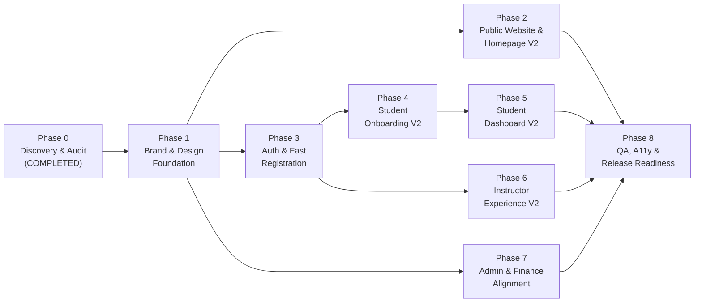

# SKILLUP DIGITECH ACADEMY — REBRAND V2 PHASED IMPLEMENTATION ROADMAP

**Document ID:** Document 4 of 5 (`SKILLUP_REBRAND_V2_IMPLEMENTATION_ROADMAP.md`)  
**Date:** 2026-11-17  
**Governance Rule:** Each phase is independently reviewable, tested before advancing, and preserves all working PostgreSQL, Paystack, Brevo, and HttpOnly cookie RBAC infrastructure.

---

## 1. Phase Dependency Overview

---

## 2. Detailed Phased Implementation Plan

### Phase 0 — Discovery and Audit (**COMPLETED**)
- **Deliverables Completed:**
  - `docs/audits/SKILLUP_REBRAND_V2_BROWSER_AUDIT.md`
  - `docs/audits/SKILLUP_REBRAND_V2_MASTER_AUDIT.md`
  - `docs/audits/SKILLUP_REBRAND_V2_USER_JOURNEYS.md`
  - `docs/audits/SKILLUP_REBRAND_V2_COMPONENT_AUDIT.md`
  - `docs/audits/SKILLUP_REBRAND_V2_IMPLEMENTATION_ROADMAP.md`
  - `docs/audits/SKILLUP_REBRAND_V2_PAGE_INVENTORY.md`
- **Gate:** Stakeholder review and approval before editing production UI code.

---

### Phase 1 — Brand & Design Foundation (**Priority: Critical — Recommended Starting Point**)
- **Depends On:** Phase 0 approval.
- **Objective:** Eliminate the Tech Blue vs. Russian Violet split-brain identity globally, load real brand fonts, remove the blocking `CurrencyModal` & heavy `AnimatedBackground`, and decommission the legacy PromptCare Caregiver campaign page.
- **Expected Files Affected:**
  - `app/globals.css` (replace `#2563eb`/`#0284c7` tokens with Russian Violet `#231651`, Deep Night Plum `#150C33`, Electric Violet `#613399`, Mint `#D6FFF6`, Emerald `#0A5C4A`, Soft Ice Lavender `#E8E3F5`, Light Canvas `#F8FAFB`).
  - `app/layout.tsx` (load `Plus_Jakarta_Sans`, `Inter`, and `JetBrains_Mono` via `next/font/google`; remove `<CurrencyModal />`; default `preferences-storage` currency to `NGN` in `lib/store.ts`).
  - `components/ui/logo.tsx`, `components/ui/button.tsx` (add `outline-dark` high-contrast variant + `min-h-11` mobile targets), `components/ui/badge.tsx` (add `mint`, `lavender`, `violet` variants), `components/ui/input.tsx`, `components/ui/select.tsx`.
  - `components/skillup/role-dashboard-shell.tsx`, `components/skillup/dashboard-nav.tsx` (dynamic per-page `<h1>`, ≥44px touch targets).
  - Decommission `app/(public)/campaign/promptcare-academy/*` (redirect `/campaign/promptcare-academy` -> `/courses`) and remove unused `home-scroll-video-section.tsx`, `protected-route.tsx`, `metric-card.tsx`, `shared-countdown-banner.tsx`.
- **Acceptance Criteria:**
  - Zero `#2563eb` generic blue buttons/pills remaining on primary surfaces.
  - First-time visitor loads `/` with zero blocking modal and NGN default pricing.
  - `/campaign/promptcare-academy` redirects cleanly to `/courses` (no healthcare text anywhere in rendered HTML).
  - `Plus Jakarta Sans` & `Inter` render in computed browser styles.
- **Tests Required:** `npx tsc --noEmit`, visual screenshot regression check across `/` and `/dashboard`, `npm run test:security`.

---

### Phase 2 — Public Website & Homepage V2 (**Priority: High**)
- **Depends On:** Phase 1.
- **Objective:** Transform `/` and public pages into a conversion-focused, credible technology academy experience targeting Teens (13–18), Parents, and Adults.
- **Expected Files Affected:**
  - `components/layout/public-header.tsx` + new `components/layout/get-started-drawer.tsx` (minimalist header + responsive content-shift push drawer presenting *Student* vs *Instructor* vs *Sign In*).
  - `components/layout/public-footer.tsx` (Deep Night Plum footer + compact inline currency switcher + `/verify` + Enugu Centre address).
  - `components/skillup/hero.tsx`, `components/skillup/dual-pathways-section.tsx`, `components/skillup/cta-band.tsx`.
  - `app/(public)/page.tsx` (consolidate to 7 focused sections; remove decorative marquee & duplicate `components/testimonials.tsx`; add compact Enugu Centre Credibility block + 5-item FAQ accordion).
  - `components/skillup/filter-panel.tsx` (add explicit accessible labels on `/courses`).
  - `app/(public)/verify/page.tsx` (add explicit `<Label>` for code input).
- **Acceptance Criteria:**
  - Mobile homepage scroll height reduced from `10,301px` to `<= 5,800px` with zero horizontal overflow.
  - Zero duplicate methodology sections; zero fabricated testimonials.
  - Push drawer shifts main content smoothly on desktop and opens full-width cleanly on 390px mobile without trapping keyboard focus.
- **Tests Required:** Playwright responsive audit (1440, 1280, 768, 390), keyboard Tab/Escape accessibility test on push drawer.

---

### Phase 3 — Authentication & Fast Registration (**Priority: Critical**)
- **Depends On:** Phase 1.
- **Objective:** Streamline initial account creation to 1 fast screen, fix broken `/welcome/*` loading states, harden OTP UX, and unify auth layouts without regressing HttpOnly cookie security.
- **Expected Files Affected:**
  - `app/(auth)/layout.tsx` (clean `AuthCardLayout`, remove `AnimatedBackground`).
  - `app/(auth)/register/page.tsx` + rebuilt `components/auth/student-signup-form.tsx` (1 screen: Full Name, Email, Password, Age Group `Teen 13–18` / `Adult 18+`, Terms -> triggers OTP).
  - `app/(auth)/register-instructor/page.tsx` + rebuilt `components/auth/instructor-signup-form.tsx` (1 screen: Full Name, Email, Password, Phone, Terms -> triggers OTP).
  - `app/(auth)/verify-otp/verify-otp-client.tsx` (single wide monospace 6-digit box, paste support, graceful fallback when `?email=` is omitted).
  - `app/(auth)/login/page.tsx` (preserve unified role routing, clear expired-session messaging).
  - `app/api/auth/register/route.ts` & `lib/validation.ts` (allow lightweight account creation while deferring pathway/BYOL/safeguarding to Phase 4 onboarding — strictly keeping BYOL & guardian consent mandatory before hybrid/minor enrollment completes!).
- **Acceptance Criteria:**
  - Student or Instructor can create an account and reach `/verify-otp` in under 60 seconds (1 screen, 5 fields).
  - Duplicate emails fail immediately on Step 1 with clear sign-in/reset recovery links.
  - HttpOnly `token` cookie authentication, `proxy.ts` protection, and admin authorization fixes remain 100% intact.
- **Tests Required:** `npm run test:security`, `npm run test:email`, `npm run test:academic`, Playwright login/logout/refresh/invalid-credentials/redirect suite.

---

### Phase 4 — Student Progressive Onboarding V2 (**Priority: Critical**)
- **Depends On:** Phase 3.
- **Objective:** Replace the broken `/welcome/student` infinite spinner AND the cluttered legacy `/dashboard/profile/setup` (which contains `isHealthcareProfessional` and `abuja`) with a single clean post-OTP guided onboarding flow.
- **Expected Files Affected:**
  - `components/auth/onboarding-shell.tsx` (rebuild into single-column `max-w-2xl` shell with **one** top progress indicator; delete `onboarding-preview.tsx`).
  - `app/welcome/student/page.tsx` (redirect or host clean 3-step `/onboarding/student` flow with `credentials: "include"`).
  - `app/dashboard/profile/setup/page.tsx` & `app/api/profile/setup/route.ts` (remove `isHealthcareProfessional` & `abuja`; redirect legacy links cleanly).
  - `lib/student-registration.ts`, `lib/types.ts` (remove legacy caregiver form title `"Become a World-Class Certified Caregiver in 21 Days"` and `abuja` defaults).
  - Connect Onboarding Step 1 dynamically to live `GET /api/programmes` & `GET /api/courses` (eliminating stale hardcoded `SPECIALIST_COURSES` prices!).
- **Acceptance Criteria:**
  - Zero infinite spinners on `/welcome/student` even after hard browser refresh.
  - Basic AI 101 and Basic Digital Literacy accurately display as **FREE (₦0)** from live PostgreSQL data.
  - Hybrid learners see Enugu Main Learning Centre fixed-timetable notice and must check BYOL acknowledgement before proceeding.
  - Teen learners (13–18) complete safeguarding & trigger Brevo guardian consent email; Adult learners skip safeguarding completely.
- **Tests Required:** `npm run test:academic` (BYOL + minor safeguarding rules), Playwright walkthrough of both Teen and Adult onboarding flows.

---

### Phase 5 — Student Dashboard & Profile V2 (**Priority: High**)
- **Depends On:** Phase 4.
- **Objective:** Replace cluttered 27–44 card student screens with a calm, state-aware learning dashboard focused on the learner's single next action.
- **Expected Files Affected:**
  - `app/dashboard/page.tsx` (fix white-on-white `"Browse Catalog"` button; remove hardcoded Tuesday Google Meet link for unenrolled students; implement all 5 lifecycle states with live `class_sessions` timetable).
  - `app/dashboard/onsite-training/page.tsx` -> refactor into **Campus & Schedule** view powered by real PostgreSQL cohorts/sessions (removing fabricated `"48+ learners enrolled"` and past `"March 7, 2026"` copy).
  - `app/dashboard/profile/page.tsx` (reduce from 44 cards to 3 clean tabs: Account, Academic & Safeguarding, Security; fix clipped `"xplore courses"` button; remove contradictory `0%` vs `Setup Complete` copy).
  - `app/dashboard/courses/page.tsx`, `app/dashboard/certificates/page.tsx`, `app/dashboard/payments/page.tsx` (align empty states, dynamic `<h1>` headers, V2 tokens).
- **Acceptance Criteria:**
  - Contrast ratio `>= 4.5:1` on every button/badge (verified in dark Russian Violet hero).
  - Unenrolled students see accurate empty state with clear next action (zero fake schedules).
  - Active hybrid students see real Enugu Lab sessions, attendance %, BYOL notice, and Capstone status.
  - `/dashboard/profile` has `<= 8` clean cards and zero clipped buttons at 1440px, 768px, and 390px.
- **Tests Required:** Playwright visual + DOM audit across all 5 student states at 1440px and 390px.

---

### Phase 6 — Instructor Onboarding & Dashboard V2 (**Priority: High**)
- **Depends On:** Phase 3.
- **Objective:** Differentiate the instructor workspace around teaching responsibilities, fix `/welcome/instructor` infinite spinner, consolidate duplicate course routes, and fix mobile ergonomics.
- **Expected Files Affected:**
  - `app/welcome/instructor/page.tsx` (fix missing `credentials: "include"` infinite spinner; transform into crisp 2-step teaching profile & academic standards setup).
  - `app/instructor/page.tsx` (rebrand to V2 tokens; prioritize Today's Teaching Schedule -> Pending Grading Queue -> Assigned Courses/Cohorts; reduce mobile height from `6,522px` to `< 2,800px`).
  - `app/instructor/create-course/page.tsx` & `app/instructor/edit-course/[courseId]/page.tsx` (consolidate/redirect cleanly to canonical `/instructor/courses/new` & `/instructor/courses/[courseId]/edit`).
  - `app/instructor/courses/new/page.tsx` & `app/instructor/evaluations/page.tsx` (add explicit `<Label>` to all 7+ unlabeled inputs).
- **Acceptance Criteria:**
  - Zero infinite spinner on `/welcome/instructor`.
  - Instructors see live assigned `class_sessions` + one-click jump to `/instructor/attendance` and pending submissions queue on `/instructor`.
  - Zero unlabeled form inputs; mobile touch targets `>= 44px`; admin-only permissions remain strictly excluded.
- **Tests Required:** `npm run test:security` (instructor isolation + self-approval block), Playwright instructor console audit (1440px & 390px).

---

### Phase 7 — Admin & Finance Experience Alignment (**Priority: Medium**)
- **Depends On:** Phase 1.
- **Objective:** Align all admin and finance consoles to Rebrand V2 tokens and retire legacy healthcare/Abuja configuration clutter while preserving every working operational console.
- **Expected Files Affected:**
  - `app/admin/layout.tsx`, `app/finance/layout.tsx` (V2 tokens, dynamic per-page `<h1>`; preserve all hardened cookie auth fixes!).
  - `app/admin/onsite-training/page.tsx` & `app/admin/campaign/page.tsx` (retire legacy Abuja onsite form with 20 unlabeled inputs & PromptCare campaign editor from admin sidebar; redirect/archive safely into Campuses & Cohorts).
  - `app/admin/page.tsx`, `app/admin/courses/page.tsx`, `app/admin/students/page.tsx`, `app/admin/users/page.tsx`, `app/admin/payments/page.tsx` (consistent V2 tokens & mobile table scroll wrappers).
- **Acceptance Criteria:**
  - Admin can seamlessly manage Campuses, Classrooms, Cohorts, Timetables, Courses, Users, Students, Payments, and Tuition Installments with unified branding and zero legacy Abuja/PromptCare UI.
  - Zero regressions to `POST /api/campuses/[campusId]/classrooms` or hard-refresh session persistence.
- **Tests Required:** `npm run test:security`, `npm run test:academic`, `npm run test:payments`, Playwright admin walkthrough.

---

### Phase 8 — Quality Assurance, Accessibility & Release Readiness (**Priority: Critical**)
- **Depends On:** Phases 1–7.
- **Objective:** Comprehensive automated, responsive, accessibility, performance, and build verification prior to launch.
- **Verification Checklist:**
  - [ ] `npm run test:academic` — 100% pass
  - [ ] `npm run test:security` — 100% pass (including cookie/Bearer auth & RBAC isolation)
  - [ ] `npm run test:email` — 100% pass (Brevo exclusivity & idempotency)
  - [ ] `npm run test:payments` — 100% pass (Paystack verification)
  - [ ] `npx tsc --noEmit` — 0 TypeScript errors
  - [ ] `npm run build` — Clean Turbopack production build across all routes
  - [ ] Playwright responsive sweep at `1440px`, `1280px`, `768px`, `390px`: 0 horizontal overflow, 0 broken images, 0 unlabeled inputs, 0 `<44px` primary mobile touch targets, 0 WCAG AA contrast failures, 0 legacy PromptCare/Caregiver/Abuja strings.
  - [ ] Final release readiness report generated.

---

## 3. Risks & Mitigations

| Risk | Likelihood | Impact | Mitigation |
| :--- | :---: | :---: | :--- |
| **Breaking BYOL or Minor Safeguarding Validation** when simplifying `/register` to 1 screen | Medium | High | Keep strict validation rules in `lib/validation.ts` enforced at onboarding/enrollment completion so no hybrid/minor enrollment can activate without BYOL & guardian consent. |
| **Regressing Hardened Admin Cookie Auth** during layout redesign | Low | Critical | Keep `getTokenFromRequest` + `credentials: "include"` + `20000ms` Neon pool timeout untouched; run `tests/security/admin-authorization-fixes.test.ts` on every phase. |
| **Breaking Bookmarked Legacy Routes** (`/register-online`, `/instructor/create-course`, `/dashboard/profile/setup`) | Medium | Medium | Implement server-side Next.js `redirect()` stubs instead of hard 404s for consolidated routes. |
| **Scope Creep into Backend Rewrites** | Medium | High | Strictly freeze database schema (`db/schema/*`), Paystack webhook logic, and Brevo service during UI phases unless an approved bug requires a tiny additive fix. |
