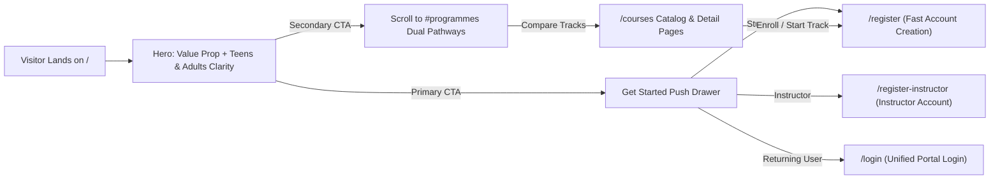
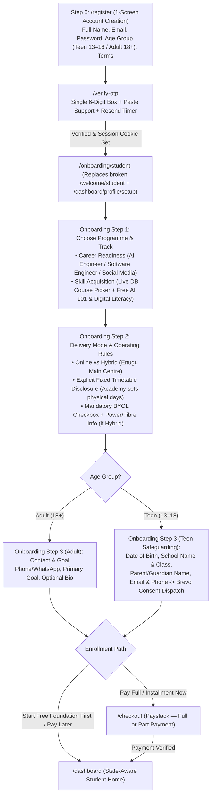
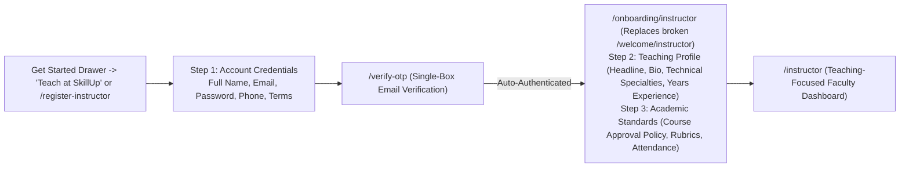
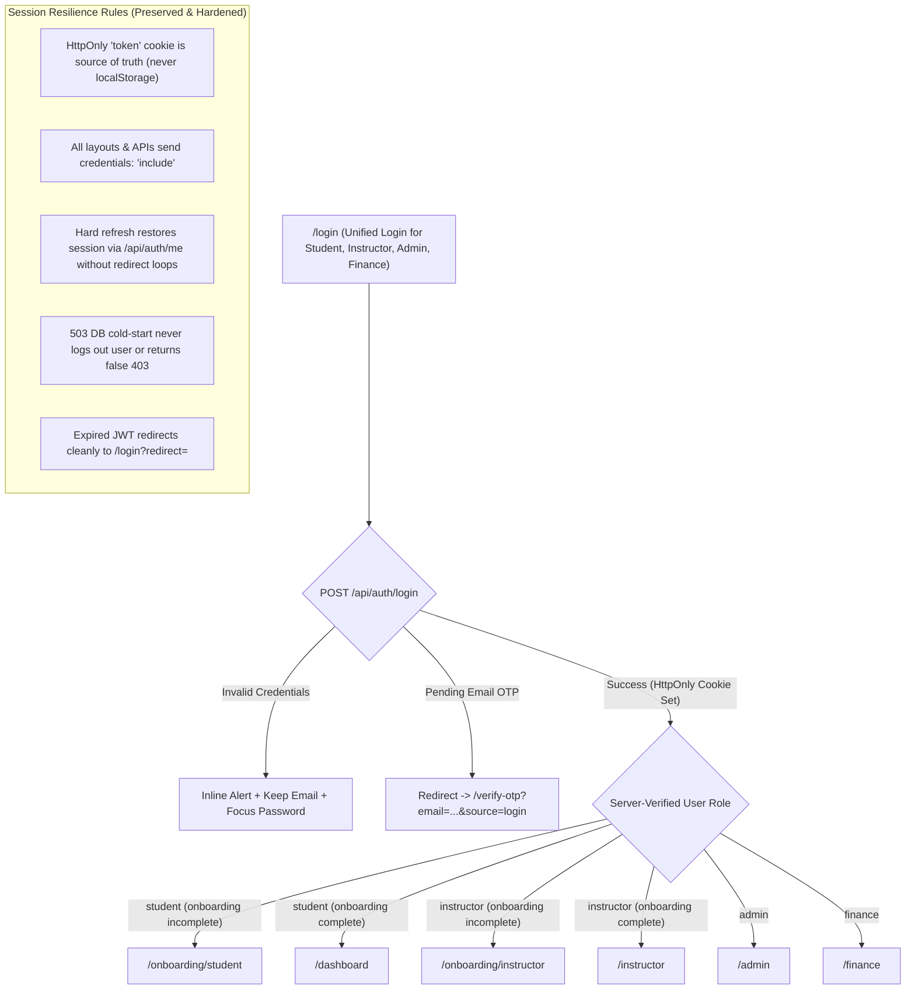

# SKILLUP DIGITECH ACADEMY — REBRAND V2 USER JOURNEYS & SCREEN SPECIFICATIONS

**Document ID:** Document 2 of 5 (`SKILLUP_REBRAND_V2_USER_JOURNEYS.md`)  
**Date:** 2026-11-17  
**Scope:** End-to-end redesign of Visitor, Teen Student (13–18), Adult Student (18+), Instructor, Administrator, Authentication, and Error/Recovery journeys.

---

## 1. Visitor Discovery & Conversion Journey

### Before vs. After Comparison
- **Before (Current):** Visitor lands on `/` -> blocked by broken USD `CurrencyModal` -> sees generic software headline + 10 sections (10,301px on mobile) -> clicks `"Sign Up"` or `"Explore Courses"` -> dropped into a 6–7 step registration form with hardcoded stale course prices.
- **After (Rebrand V2):** Visitor lands on `/` (no blocking modal; NGN default) -> understands SkillUp's dual programmes (Career Readiness vs. Skill Acquisition) and audiences (Teens 13–18 & Adults) in <10 seconds -> clicks **`Get Started`** -> responsive content-shift push drawer opens cleanly with **Student** vs **Instructor** pathways -> enters fast 1-screen account creation.

---

## 2. Student Registration & Progressive Onboarding Journey (Unified + Age-Aware)

### Critical Design Decision: Separate Account Creation from Onboarding
The current `/register` forces **20+ inputs across 6–7 steps before an account exists**, then asks overlapping questions *again* in `/dashboard/profile/setup`.  
**Rebrand V2 Recommendation:** Split cleanly into **Fast Account Creation (1 screen, <60 seconds)** -> **Email OTP Verification (1 screen, single wide input)** -> **Guided Academic Onboarding (3 concise steps, 4 if Teen 13–18)** -> **Enrollment / Checkout or Immediate Free Foundation Start** -> **State-Aware Student Dashboard**.

### 2.1 Teen Student Journey (Ages 13–18) — Safeguarding Built In
1. Selects **"Teen Learner (Ages 13–18)"** on `/register` (friendly, respectful language — never condescending).
2. Verifies email via `/verify-otp`.
3. In Onboarding Step 2, sees clear Enugu Main Learning Centre expectations (guardian drop-off/venue info, BYOL laptop checklist, fixed cohort schedule).
4. In Onboarding Step 3 (**Safeguarding**), enters Date of Birth, School Name, Grade/Class, and Parent/Guardian Name, Email, and Phone.
5. System dispatches the existing **Brevo Guardian Consent Email** with cryptographic token linking to `/guardian-consent`.
6. Lands on `/dashboard`:
   - Can immediately begin self-paced **Foundation Courses** (`Basic AI 101`, `Basic Digital Literacy`) and review course syllabi.
   - Displays a clear, non-alarming **"Awaiting Parent/Guardian Consent"** status banner with a one-click **"Resend Consent Link"** button until `guardianConsentStatus === 'verified'`.
   - Moderated academic inquiry rules remain active for minors.

### 2.2 Adult Student Journey (Ages 18+) — Zero Unnecessary Friction
1. Selects **"Adult Learner (18+)"** on `/register` -> enters Name, Email, Password, accepts Terms.
2. Verifies email via `/verify-otp` (auto-signed-in via HttpOnly cookie — no redundant re-login required!).
3. In Onboarding Steps 1–3: selects Programme & Track (from live `/api/programmes` & `/api/courses` — never hardcoded), picks Delivery Mode (Online vs Hybrid with mandatory BYOL acknowledgement and fixed-timetable notice if Hybrid), adds Phone/WhatsApp + learning goal.
4. Proceeds straight to `/checkout` (Full payment or Installment plan) OR starts immediately on `/dashboard` with free foundation access and a clear **"Complete Enrollment"** next action.

### 2.3 Operating Rules Strictly Enforced in Onboarding
- Physical/hybrid students attend at **Enugu Main Learning Centre (14 Garden Avenue, GRA, Enugu)**.
- **BYOL Disclosure:** Must explicitly acknowledge bringing their own laptop (Core i5/Ryzen 5+, 8GB RAM, 256GB SSD) before hybrid enrollment can complete.
- **Centre Facilities:** Clearly state academy-provided 100% dual-source power (generator + solar) and enterprise fibre internet.
- **Fixed Timetable Transparency:** Explicitly inform hybrid learners that the academy assigns scheduled physical-class days per cohort (e.g., Wednesdays Virtual, Saturdays Physical Lab) and may revise timetables — students **never** pick arbitrary physical attendance days.

---

## 3. Instructor Registration & Onboarding Journey

### Verified Current State vs. Target Redesign
- **Current Reality (Verified in Code):** `POST /api/auth/register-instructor` supports open self-registration with email OTP verification (`role: "instructor"` activated upon OTP verification; courses require admin approval before publishing). No separate instructor approval gate exists today.
- **Current Friction:** `/register-instructor` forces 8 single-input micro-steps, prematurely ticks Step 6 on Step 1, and lands on `/welcome/instructor` which hangs on an infinite spinner!
- **Rebrand V2 Redesign (3 Clean Steps + Dedicated Faculty Onboarding):**

- **Essential vs. Optional Split:**
  - *Required at Registration:* Full Name, Email, Password, Phone, Terms.
  - *Guided Post-OTP Setup (skippable to `/instructor/settings`):* Professional Headline, Technical Specialties, Years of Experience, Short Biography, Profile Avatar, Availability.
- **Governance Transparency:** Clearly explain during Step 3 that instructors can draft courses and modules immediately, while **Admin Approval** is required before a course goes live in the public catalog.

---

## 4. Unified Authentication, Session & Role-Routing Journey

---

## 5. Role Dashboard Entry States & Information Hierarchy

### 5.1 Student Dashboard (`/dashboard`) — 5 Lifecycle States

| Student Lifecycle State | Dominant Hero / Next Action | Primary Dashboard Modules | Moved to Secondary Navigation |
| :--- | :--- | :--- | :--- |
| **1. Newly Registered (No Programme Yet)** | *"Choose Your Programme or Start Free Foundation Courses"* (`Explore Programmes` / `Start Basic AI 101`) | 1. Free Foundation Starter Cards (`AI-101`, `BDL-101`) 2. Pathway Comparison Prompt | Payments, Certificates, Profile Settings |
| **2. Awaiting Enrollment / Guardian Consent / Deposit** | *"1 Step Left to Activate Your Cohort"* (`Complete Payment` or `Resend Guardian Consent`) | 1. Clear Action Checklist (max 3 items) 2. Assigned Track Preview + Free Foundations | Payment History, Old Invoices |
| **3. Active Student (Online Skill Acquisition)** | **`Resume Next Lesson`** (Course Title, Module, % Progress, Est. Time) | 1. Active Courses Grid (with Free Foundations badge) 2. Pending Quizzes / Assignments 3. Quick `"Ask Instructor"` Action | Full Profile Tabs, Receipts, Certificates |
| **4. Active Student (Hybrid Career Readiness)** | **`Next Scheduled Session`** (Date, Time, Enugu Lab / Meet Link) + **`Resume Lesson`** | 1. Active Pathway & Cohort Progress Bar + Attendance Rate (target ≥75%) 2. This Week's Fixed Timetable (from live `class_sessions` — NEVER hardcoded!) 3. Pending Assignments & Capstone Milestone 4. BYOL Reminder & Enugu Centre Info | Full Campus Specs, Payment Schedule, Profile |
| **5. Graduated / Completed Student** | **`Download & Verify Certificate`** (`SKILLUP-YYYY-XXXX`) | 1. Earned Certificates & Verification Links 2. Capstone Evaluation Summary & Distinction Badge 3. Recommended Next Skill Track | Legacy Invoices, Settings |

### 5.2 Instructor Dashboard (`/instructor`) — Teaching-First Hierarchy
- **Primary Dashboard Home:**
  1. **Action Header:** Greeting + quick buttons (`+ Create Course`, `Mark Attendance`, `Review Submissions`).
  2. **Today / This Week's Teaching Schedule:** Live `class_sessions` assigned to this instructor (Physical Lab room or Virtual Meet link + quick **"Take Attendance"** button).
  3. **Grading & Evaluation Queue:** Pending assignment and capstone project submissions needing rubric grading.
  4. **Assigned Courses & Cohorts:** Compact list with status (`Published`, `Pending Admin Approval`, `Draft`) and quick edit/content links.
- **Moved to Secondary Navigation:** Full Analytics charts (`/instructor/analytics`), Instructor Profile & Availability (`/instructor/settings`), Asset Uploads (`/instructor/upload`).
- **Admin Boundaries Preserved:** Zero exposure of user management, payments, campus creation, or course self-approval.

---

## 6. Screen-by-Screen Specification Matrix (All Proposed Core Screens)

| Screen & Route | Purpose | Primary User(s) | Information Displayed | Primary Action | Secondary Action | Required Shared Components | Explicitly Excluded |
| :--- | :--- | :--- | :--- | :--- | :--- | :--- | :--- |
| **Homepage** (`/`) | Explain SkillUp, audiences (Teens & Adults), dual programmes, and convert visitors | Prospective students, parents, instructors | Value hero, Dual Pathways compare, How SkillUp Works (4 steps), Live Featured Courses, Enugu Centre & Credibility, 5 FAQs, Footer | `Get Started` (opens push drawer) | `Explore Programmes` / `Browse Courses` | `PublicHeader`, `GetStartedDrawer`, `DualPathwaysSection`, `CourseCard`, `PublicFooter` | Blocking `CurrencyModal`, decorative marquee, duplicate `Testimonials` methodology, PromptCare campaign |
| **Student Registration** (`/register`) | Create student account with minimal friction | New Teen (13–18) & Adult (18+) learners | Full Name, Email, Password, Age Group selector (`Teen 13–18` / `Adult 18+`), Terms checkbox | `Create Account` | `Sign In` / `Register as Instructor` | `AuthCardLayout`, `PasswordInput`, `AgeGroupToggle` | 6-step wizard, hardcoded course prices, phone/address/DOB/healthcare questions |
| **Email Verification** (`/verify-otp`) | Verify email ownership & establish session | Newly registered students & instructors | Masked email, single wide monospace 6-digit OTP box (paste-friendly), countdown timer | `Verify & Continue` | `Resend Code` / `Change Email` | `AuthCardLayout`, `SingleOtpInput` | Multi-box brittle inputs, jargon, broken empty state when email missing |
| **Student Onboarding** (`/onboarding/student`) | Personalize academic pathway, delivery mode, BYOL, and safeguarding | Newly verified students | Step 1: Live Programme/Track; Step 2: Online vs Hybrid + Fixed Timetable + BYOL checkbox; Step 3: Contact/Goal (Adult) or School + Guardian Consent (Teen) | `Continue` / `Go to Checkout or Dashboard` | `Back` / `Skip to Free Foundations` | `StepProgressBar` (1 indicator only), `PathwaySelector`, `DeliveryModeCard`, `ByolNoticeCard` | Double sidebars, triple progress bars, `isHealthcareProfessional`, `"abuja"`, internal funnel jargon |
| **Student Dashboard** (`/dashboard`) | Drive single clearest next learning action | Authenticated students (all 5 states) | State-aware Hero (`Resume Lesson` / `Next Class` / `Choose Track`), Live Programme & Progress Card, Live Cohort Timetable (if hybrid), Pending Work, `Write to Instructor` | State-specific single primary CTA | `View All Courses` / `Write to Instructor` | `RoleDashboardShell`, `PageHeader`, `NextActionHero`, `CohortTimetableCard`, `EmptyState` | 27+ nested cards, hardcoded Tuesday Google Meet link for unenrolled users, white-on-white buttons, fake `"48+ enrolled"` stats |
| **Student Profile** (`/dashboard/profile`) | Clean account & academic record management | Authenticated students | 3 clean tabs: `Account & Contact`, `Academic & Safeguarding`, `Security & Password` | `Save Changes` | `Change Password` | `RoleDashboardShell`, `Tabs`, `FormField` | 44 cards, dual completion rings, clipped buttons, onsite marketing ads |
| **Instructor Registration** (`/register-instructor`) | Fast faculty account intake | Prospective instructors | Full Name, Email, Password, Phone, Terms (1 clean screen -> OTP -> 2-step teaching profile) | `Create Instructor Account` | `Sign In` / `Register as Student` | `AuthCardLayout`, `PasswordInput` | 8 single-field micro-steps, premature checkmark on Step 6 |
| **Instructor Dashboard** (`/instructor`) | Focus faculty on classes, attendance & grading | Authenticated instructors | Teaching Schedule (live sessions), Pending Grading Queue, Assigned Courses & Cohorts | `Take Attendance` / `Grade Submissions` | `+ Create Course` | `RoleDashboardShell`, `PageHeader`, `SessionListCard`, `GradingQueueCard` | Heavy multi-chart bloat above fold, 6,522px mobile stack, admin controls |
| **Unified Login** (`/login`) | Secure authentication for all roles | Student, Instructor, Admin, Finance | Email, Password, Remember Me, Forgot Password link | `Sign In` | `Create Account` / `Forgot Password` | `AuthCardLayout`, `PasswordInput` | Redundant separate `/login-admin` UX confusion |

---

## 7. Error & Alternative Journeys

| Scenario | Current Behavior | Rebrand V2 Target Behavior |
| :--- | :--- | :--- |
| **Duplicate email on `/register`** | Returns 409 error inside Step 6 after filling 20 fields! | Caught immediately on 1-screen `/register` with inline `"Account exists — Sign in or Reset Password"` CTA. |
| **Direct hit on `/verify-otp` without `?email=`** | Shows dead 53-word screen with `0` inputs. | Allows entering email address or clicking `"Return to Login / Registration"`. |
| **Expired JWT / Logged-out tab** | Sometimes bounces with empty header or stale Zustand user. | `proxy.ts` + layout redirects cleanly to `/login?redirect=<encodedPath>` with calm `"Your session expired — sign in to continue"` banner. |
| **Transient Neon DB Cold-Start (503)** | Previously caused false `403` (fixed in backend). | UI displays non-destructive retry banner (`"Reconnecting to academy servers..."`) without clearing session or logging user out. |
| **Full Hybrid Cohort Capacity (`409 CAPACITY_EXCEEDED`)** | API returns 409; registration UI doesn't preview seat counts. | Live seat counter shown in Onboarding Step 2; if cohort is full, automatically offers **Online Delivery** or next intake waitlist. |
| **Guardian Rejects or Delays Consent (Teen)** | Status stored in DB, minimal student UI guidance. | Clear status banner on `/dashboard` allowing teen to update guardian email or resend Brevo consent request while keeping free self-paced modules readable. |
